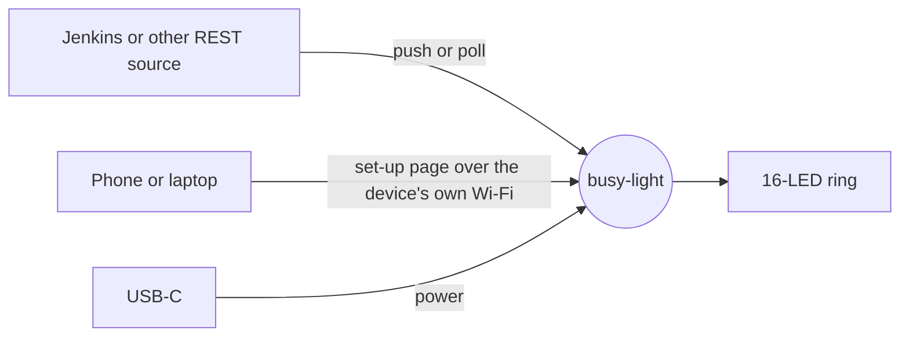
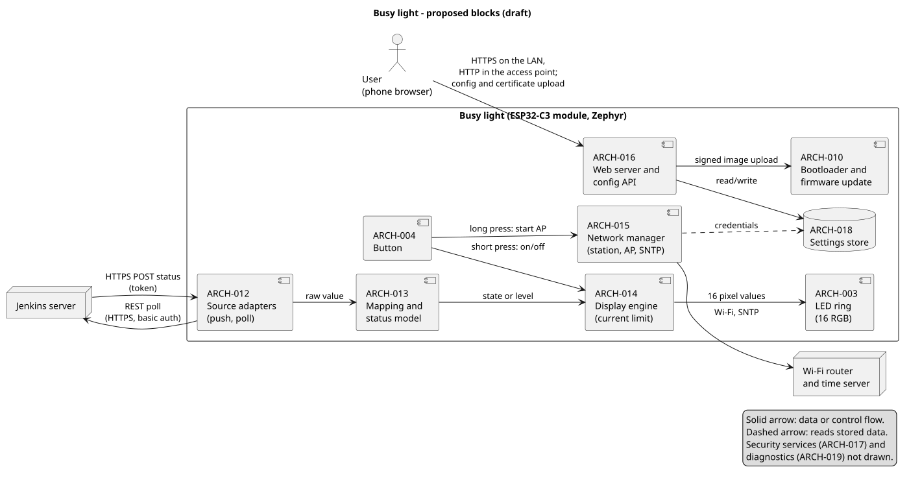
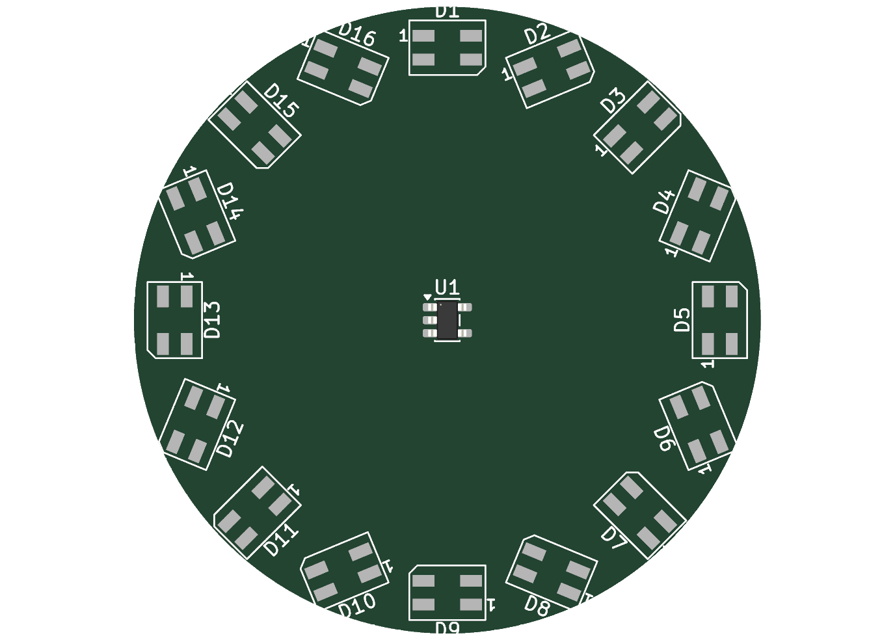
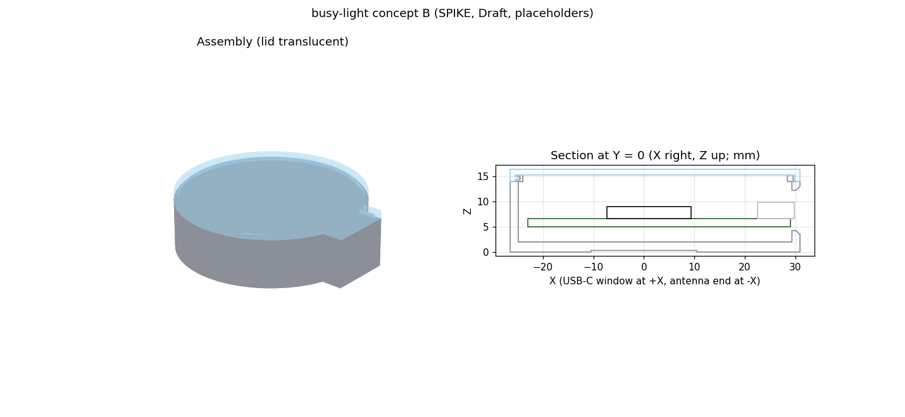

<div align="center">

# busy-light

**A Wi-Fi status ring for desks, doors and build rooms.**
Sixteen RGB LEDs that show your Jenkins build status or any other level, with no app and no cloud account.

[](https://github.com/spoorcc/busy-light/actions/workflows/ci.yml)


-003399)
[](LICENSES/Apache-2.0.txt)
[](LICENSES/CC-BY-NC-SA-4.0.txt)
[](CONTRIBUTING.md)

[Documentation](docs/README.md) ·
[Requirements](docs/requirements/needs.md) ·
[Architecture decisions](docs/decisions/) ·
[Roadmap](#roadmap) ·
[Contributing](CONTRIBUTING.md) ·
[Security](SECURITY.md)

</div>

---

> **Honest status:** busy-light is in the **design phase**. There is no released firmware, no manufactured
> hardware and no approved requirement set yet. Everything below describes the **intended** product and
> what the project has already proved with desk studies, PC prototypes and CAD experiments.
> Nothing here is certified, and no conformity with any regulation is claimed.

## What is it?

busy-light is a small round device with a ring of 16 individually controllable RGB LEDs. It joins your Wi-Fi,
listens to your build server or fetches its status over REST, and turns that into a colour or a level you can see
from across the room.

The first use case is a **Jenkins build light**: green, red, unstable, running, aborted. The second is a
**level gauge**: the ring fills like a dial from 0 to 100 percent for queue length, test pass rate, or any number
a REST endpoint can give.

## Why another status light?

Most status lights need a vendor app, a cloud account or a USB cable to a PC. busy-light is designed around a
different set of goals.

| Goal | What it means |
|------|---------------|
| **Works on a shared, untrusted network** | Per-unit access point password, encrypted provisioning, authenticated and signed updates. |
| **No app, no cloud** | Set-up and configuration through a web page served by the device itself. |
| **Small enough to put anywhere** | About 53 mm across, powered over USB-C. |
| **Cheap to build** | Target assembled board cost of EUR 10 to 20 with a prototype shop. |
| **Source-available and reproducible** | Software, hardware and mechanics are all in this repository, with generated files and checks that anyone can rerun. Code is Apache-2.0. Documentation, hardware and mechanics are free to copy and build for non-commercial use. |
| **Built like a product** | Requirements, decisions, risks and tests are traced from the first line, with EU market access (CE) in mind from day one. |

## Planned features

These are **planned**, taken from the draft requirements in [`docs/requirements/`](docs/requirements/). None is released.

- **16-LED RGB ring** with status colours, animations and a level (gauge) mode
- **Jenkins first:** receive pushed build events, or poll the Jenkins REST API
- **Mapping without code:** pick a value in the JSON answer, map it to a state or scale it to a level
- **Own access point for set-up:** the device creates a Wi-Fi network with a unique password printed on a label, you open a web page and enter your Wi-Fi details
- **Web interface** served by the device, no app to install
- **WPA2 and WPA2-Enterprise** networks, with user-loadable certificates
- **Over-the-air updates** that are signed and can be checked before they run
- **USB-C power** with safe handling of the available current: a hardware current limit and a firmware limiter on LED brightness
- **Secure boot and flash encryption** (planned for production units)



## What exists today

The project has done a lot of thinking and some experiments, but **no product code or hardware yet**.

| Area | State |
|------|-------|
| Requirements | Drafted (needs, system, software, hardware, mechanical). **None approved.** |
| Architecture decisions | 16 decision records written. Licensing (ADR-0013) is **Accepted**; the other 15 are **Proposed** (ADR-0015 would supersede ADR-0013 after its review). They cover platform, LED drive, mapping model, provisioning, update and boot security, transport, USB-C power input and current limit, housing, the hardware design flow, licensing and the mounting interface. |
| Risk register | Open. Each risk has a mitigation and a verification link. |
| Reviews | Independent "goldfish" reviews recorded for the system design, the first spike plan and the hardware flow decision ([`docs/reviews/`](docs/reviews/)). |
| Software | Zephyr 4.5.0 workspace pinned. A first build check ran. A mapping extractor and an LED current limiter were tried as **PC-only prototypes**; the results are in the reports, the code is not in `sw/`. |
| Hardware | A scripted KiCad flow was tried on a stand-in board (schematic, router, design-rule and regeneration checks). **No product schematic or layout yet.** |
| Mechanics | A FreeCAD housing concept (opaque base, translucent lid, about 53 mm) was modelled with placeholder parts. **Nothing printed or fit-tested.** |
| Regulatory | Applicability analysis and compliance matrix started. No evidence collected, no declaration made. |

The reports behind these lines are in [`docs/verification/reports/`](docs/verification/reports/).

### Gallery

All images are generated from text sources or tool exports; none is hand-drawn. None shows a product design: they show the proposal and the experiments.

**Proposed software blocks** (PlantUML source in [`docs/diagrams/plantuml/`](docs/diagrams/plantuml/), draft architecture):



| Stand-in board (KiCad 10) | Housing concept B (FreeCAD model, placeholder parts) |
|---|---|
|  |  |
| Generated by script from the hardware spike ([report](docs/verification/reports/spike-hw-kicad-pipeline.md)). A **stand-in** with 16 LEDs and one chip, **not the product board**. | From the mechanical spike. The concept is **under revision**: the owner decided that the unit is mounted horizontal and vertical, with a mounting interface on the back ([ADR-0014](docs/decisions/ADR-0014-back-mounting-interface.md)). |

## Roadmap

| Phase | Goal | State |
|-------|------|-------|
| **0. Foundation** | Process, requirements, decisions, risks, regulatory outline, CI | in progress |
| **1. Spikes** | Prove the risky parts on a dev kit: Wi-Fi access point, web page, LED drive, power budget, secure boot | planned, waiting for approval of the spike plan |
| **2. Prototype** | 10 internal prototypes: schematic, board, housing, first firmware | planned |
| **3. Verify** | Test cases against approved requirements, pre-compliance tests | planned |
| **4. Release candidate** | Signed firmware, documentation, technical file | planned |

Dates are deliberately not given. Phases start when the previous one has evidence.

## How the project works

busy-light is run like a small regulated company, because the goal is a product that could be sold.

- **Specification before implementation.** No firmware, board or housing change without an approved requirement it traces to.
- **Decisions are recorded.** Costly choices get an architecture decision record with real alternatives, weighted criteria and a critical review.
- **Evidence over claims.** A result is only reported with its test or analysis. What was not run is stated.
- **Everything is code.** Diagrams, hardware (KiCad files generated from scripts) and mechanics (FreeCAD from scripts) are text sources with checks in CI.
- **Documentation is part of the product.** User documentation follows a controlled-language standard (ASD-STE100 principles).
- **EU market access from the start.** Cyber Resilience Act, Radio Equipment Directive, RoHS and friends are tracked in [`docs/regulatory/`](docs/regulatory/README.md). The project states which evidence exists and never states that the product "is compliant".

The full process is in [`docs/process/README.md`](docs/process/README.md).

## Repository layout

| Path | Contents |
|------|----------|
| [`sw/`](sw/) | Zephyr application, west manifest, tests |
| [`hw/`](hw/) | KiCad project, simulation, fabrication outputs, datasheets |
| [`mech/`](mech/) | FreeCAD models, exports, drawings, analysis |
| [`docs/`](docs/README.md) | Process, requirements, architecture, decisions, risk, verification, regulatory, user docs, standards |
| [`scripts/`](scripts/) | Traceability, documentation and CI check scripts |

## Getting started (developers)

**Software** (needs the Zephyr SDK and `west`):

```sh
west init -l sw
west update
west build -b <board> sw/app
```

**Repository checks:**

```sh
python3 -m venv --system-site-packages .venv
.venv/bin/pip install --group dev --group hw
python3 -I scripts/check_traceability.py     # requirements, decisions, risks and tests are linked
python3 -I scripts/check_docs_style.py       # user documentation style
scripts/build_diagrams.sh --check            # diagrams are up to date
.venv/bin/ruff check . && .venv/bin/pytest   # Python tooling
```

**Hardware and mechanical checks** run in CI through `scripts/ci_hw.sh` (KiCad 10) and `scripts/ci_mech.sh` (FreeCAD).
They report **NOT RUN** until product sources exist, so a skipped check is never mistaken for a pass.

## Contributing

Ideas, reviews and critical questions are welcome. Pull requests with code or documents are not accepted until the contributor terms have had a legal check. Please read [`CONTRIBUTING.md`](CONTRIBUTING.md) first.
A good first contribution is to challenge a draft requirement or a proposed decision in
[`docs/decisions/`](docs/decisions/): write down the alternative you would pick and why.

## Security

busy-light is designed for shared networks. To report a vulnerability, follow [`SECURITY.md`](SECURITY.md).
The planned vulnerability handling and key management are drafts under
[`docs/regulatory/technical-file/05-cybersecurity/`](docs/regulatory/technical-file/05-cybersecurity).

## License

| Part | Licence |
|------|---------|
| Code (firmware, scripts, generators, CI) | [Apache-2.0](LICENSES/Apache-2.0.txt) |
| Documentation, hardware, mechanics, images | [CC BY-NC-SA 4.0](LICENSES/CC-BY-NC-SA-4.0.txt) |
| Commercial use of the hardware, mechanics or documentation | Separate licence from the owner |

You may copy, study and build from the hardware and mechanical files for non-commercial purposes. Using a unit that you
bought is not restricted. The non-commercial parts are **source-available, not open source hardware**.
Details and the path-by-path map are in [`LICENSE.md`](LICENSE.md) and [`REUSE.toml`](REUSE.toml);
the decision is [ADR-0013](docs/decisions/ADR-0013-licensing.md). Third-party parts such as Zephyr keep their own licences.
This is not legal advice.
