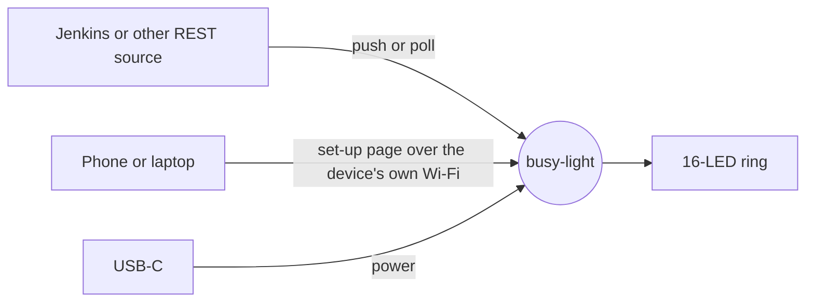
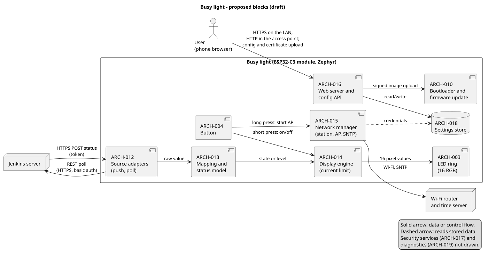
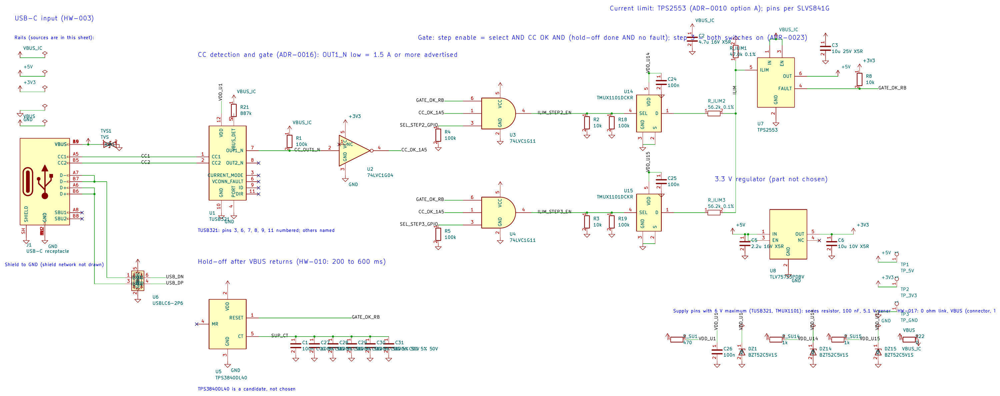
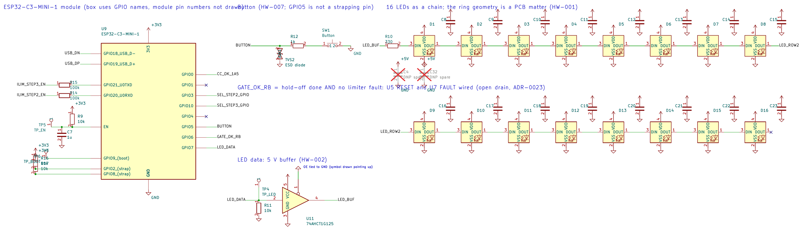
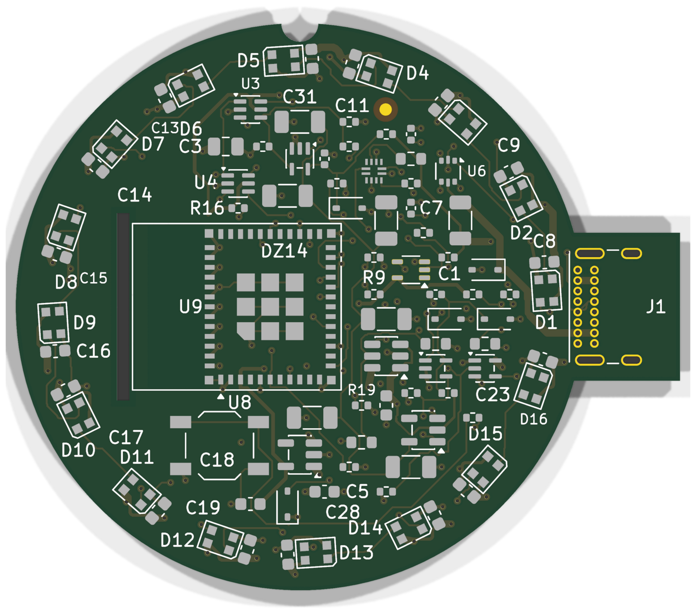
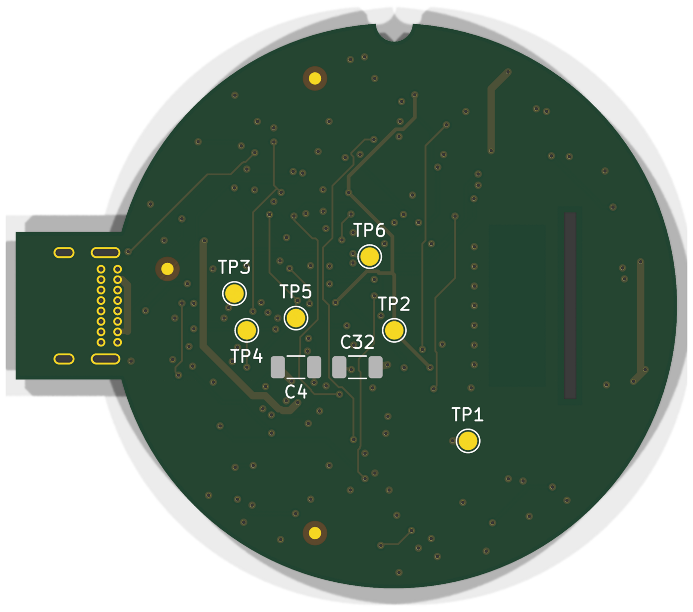
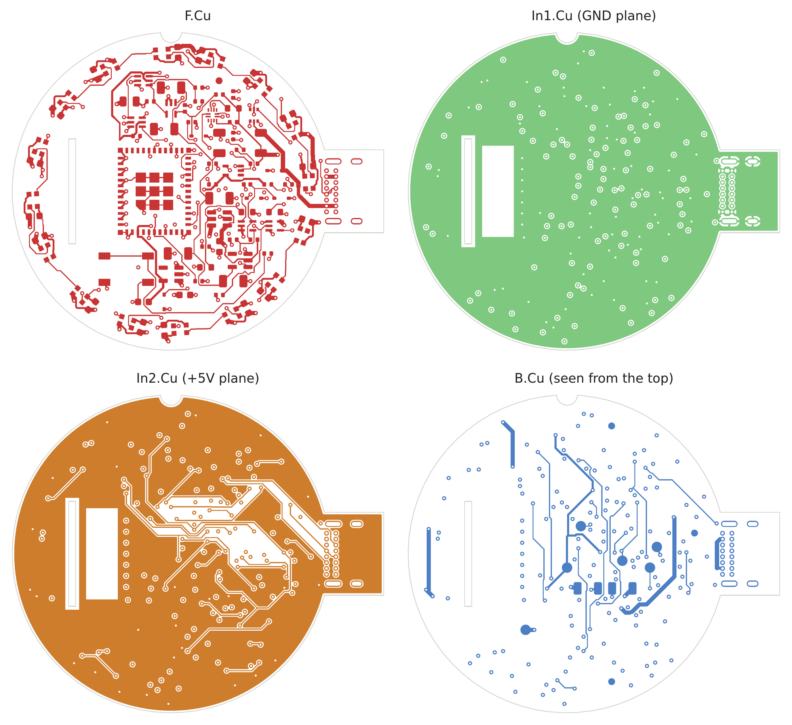
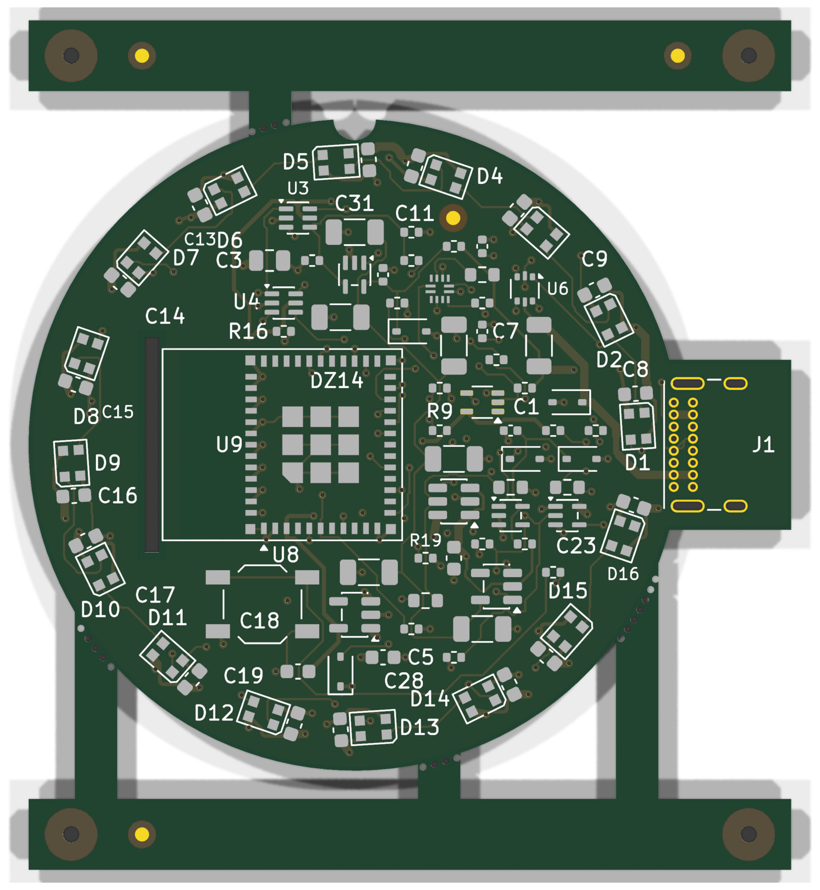
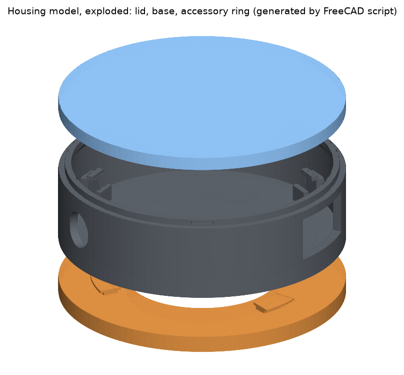
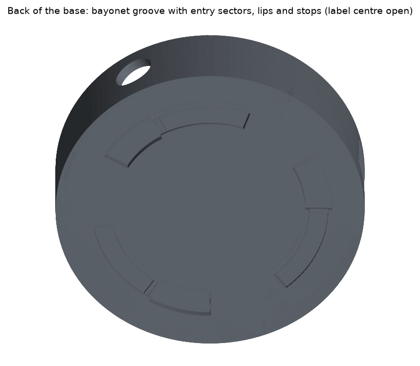

<div align="center">

# busy-light

**A Wi-Fi status ring for desks, doors and build rooms.**
Sixteen RGB LEDs that show your Jenkins build status or any other level, with no app and no cloud account.

[](https://github.com/spoorcc/busy-light/actions/workflows/ci.yml)


-003399)
[](LICENSES/Apache-2.0.txt)
[](LICENSES/CC-BY-NC-SA-4.0.txt)
[](CONTRIBUTING.md)

[Documentation](docs/README.md) ·
[Requirements](docs/requirements/needs.md) ·
[Architecture decisions](docs/decisions/) ·
[Roadmap](#roadmap) ·
[Contributing](CONTRIBUTING.md) ·
[Security](SECURITY.md)

</div>

---

> **Honest status:** busy-light is in the **design phase**. There is no released firmware, no manufactured
> hardware and no approved requirement set yet. A first prototype board (P1) is routed and checked by script,
> but a review (RV-016) found it **not ready to order**: it is placed and routed again after owner decisions. Everything below describes the **intended** product and
> what the project has already proved with desk studies, PC prototypes and CAD experiments.
> Nothing here is certified, and no conformity with any regulation is claimed.

## What is it?

busy-light is a small round device with a ring of 16 individually controllable RGB LEDs. It joins your Wi-Fi,
listens to your build server or fetches its status over REST, and turns that into a colour or a level you can see
from across the room.

The first use case is a **Jenkins build light**: green, red, unstable, running, aborted. The second is a
**level gauge**: the ring fills like a dial from 0 to 100 percent for queue length, test pass rate, or any number
a REST endpoint can give.

## Why another status light?

Most status lights need a vendor app, a cloud account or a USB cable to a PC. busy-light is designed around a
different set of goals.

| Goal | What it means |
|------|---------------|
| **Works on a shared, untrusted network** | Per-unit access point password, encrypted provisioning, authenticated and signed updates. |
| **No app, no cloud** | Set-up and configuration through a web page served by the device itself. |
| **Small enough to put anywhere** | About 53 mm across, powered over USB-C. |
| **Cheap to build** | Target assembled board cost of EUR 10 to 20 with a prototype shop. |
| **Source-available and reproducible** | Software, hardware and mechanics are all in this repository, with generated files and checks that anyone can rerun. Code is Apache-2.0. Documentation, hardware and mechanics are free to copy and build for non-commercial use. |
| **Built like a product** | Requirements, decisions, risks and tests are traced from the first line, with EU market access (CE) in mind from day one. |

## Planned features

These are **planned**, taken from the draft requirements in [`docs/requirements/`](docs/requirements/). None is released.

- **16-LED RGB ring** with status colours, animations and a level (gauge) mode
- **Jenkins first:** receive pushed build events, or poll the Jenkins REST API
- **Mapping without code:** pick a value in the JSON answer, map it to a state or scale it to a level
- **Own access point for set-up:** the device creates a Wi-Fi network with a unique password printed on a label, you open a web page and enter your Wi-Fi details
- **Web interface** served by the device, no app to install
- **WPA2 and WPA2-Enterprise** networks, with user-loadable certificates
- **Over-the-air updates** that are signed and can be checked before they run
- **USB-C power** with safe handling of the available current: a hardware current limit and a firmware limiter on LED brightness
- **Secure boot and flash encryption** (planned for production units)



## What exists today

The project has done a lot of thinking and some experiments, but **no product code or manufactured hardware yet**.

| Area | State |
|------|-------|
| Requirements | Written for needs, system, software, hardware and mechanics (105 entries). **21 are approved by the owner** (all 9 mechanical, 6 hardware including the current-limit gate HW-010 and the shop rules HW-008, 5 software, 1 system); the rest are drafts. |
| Architecture decisions | 23 decision records. **19 are accepted** by the owner (ADR-0011, the housing, only for the prototype; ADR-0023 for its decisions, its text not yet read by the owner), 2 are proposed (ADR-0020 fabrication rules, ADR-0022 how P1 gets its parts onto the board) and 2 are superseded. Recent decisions: measure the hot-plug surge on the prototype first (ADR-0021) and a simpler current-limit gate with smaller packages, so that every assembled part fits on one side (ADR-0023). |
| Risk register | Open. Each risk has a mitigation and a verification link. |
| Reviews | 17 independent "goldfish" reviews ([`docs/reviews/`](docs/reviews/)), from the system design to the P1 board plan (RV-014), the README skill (RV-015), the built P1 board (RV-016: not ready to order) and the gate simplification ADR-0023 (RV-017: rejected as written). |
| Software | Zephyr 4.5.0 workspace pinned. The input-current gate logic (`sw/app/src/gate.c`) has **20 host unit tests that pass** on `native_sim`. The application **builds** for the ESP32-C3 dev kit without warnings, but the gate logic is not in that image yet and **nothing was flashed or run on a board**. A mapping extractor and an LED current limiter were tried as PC-only prototypes (results in the reports, code not in `sw/`). |
| Hardware | A scripted KiCad flow makes the full schematic (USB-C input, CC detection, current-limit gate, hold-off, ESP32-C3 module, 16 LEDs) and the **P1 prototype board**: 46 mm, 4 layers, every assembled part on the top side ([`board-p1/`](hw/kicad/spike-gate/board-p1/README.md)). Script checks pass: strict ERC and DRC with **0 unconnected items** (only the tolerated antenna findings), no via in a pad, supply drops of 7 to 44 mV. The order package (KiKit panel, JLCPCB files) builds, but review RV-016 found the board **not ready to order**: gate-safety gaps after the ADR-0023 simplification, missed placement rules, a main path narrower than 0.6 mm and the housing size limit of MECH-001; the hold-off IC (U5) has no shop listing, and the candidate for the damping link R22 has up to 20 mΩ against the 10 mΩ of HW-017. Part datasheet evidence is recorded in a schema, **none verified**. The surge on the 5 V side is still to be **measured** on a built board. |
| Mechanics | FreeCAD scripts generate the housing (base with USB-C window, button hole, PCB posts and snap hooks, annular back bayonet with lock lips and a mating accessory ring, lid with snap bumps), print coupons for the diffuser and the bayonet, and a tolerance check with tests. **Nothing printed or fit-tested**; the tolerances are assumptions. The fit of the P1 board in the housing is **not checked**. |
| Regulatory | Applicability analysis and compliance matrix started; the P1 board changes have a regulatory check. No test evidence collected, no declaration made. |

The reports behind these lines are in [`docs/verification/reports/`](docs/verification/reports/).

### Gallery

All images are generated from text sources or tool exports; none is hand-drawn. None shows a product design: they show the proposal and the experiments.

**Proposed software blocks** (PlantUML source in [`docs/diagrams/plantuml/`](docs/diagrams/plantuml/), draft architecture):



**Prototype board P1 (KiCad 10, generated by script, checked by script, not ready to order per RV-016):**

| Schematic (P1), part 1: USB-C input, CC detection, current-step gate, hold-off, current limit, regulator |
|---|
| <a href="docs/verification/reports/images/p1-schematic-gate-power.png"></a> |

| Schematic (P1), part 2: ESP32-C3 module, button, LED buffer, 16 LEDs |
|---|
| <a href="docs/verification/reports/images/p1-schematic-mcu-leds.png"></a> |
| Two crops of one single-sheet schematic, exported with `kicad-cli`; click an image for full size. After ADR-0023 the hold-off output and the current-limit fault share one open-drain line (GATE_OK_RB). Some labels overlap (for example the values of C1 and C27 to C31, and TP6, R16 and R17 at the module) and one note runs past the sheet edge. Not reviewed, not approved. |

| P1 top (3D render) | P1 bottom (3D render) |
|---|---|
|  |  |
| Every assembled part is on the top. Placement by script (seed 47, the best of 16 seeds), routing with Freerouting 2.5.0 and a second router pass that closed the last open connection. | On the bottom: test points TP1 to TP6, the spares C4 and C32 (not fitted, HW-016) and three fiducials. |

| P1 copper layers (seen from the top) | P1 order panel (3D render) |
|---|---|
| <a href="docs/verification/reports/images/p1-pcb-layers.png"></a> |  |
| In1 is the GND plane; In2 is the +5V plane with 305 mm of signal track (still one piece). 174 vias, none in a pad. Strict DRC: **0 unconnected items**, only the 15 tolerated findings at the ESP32 module (DEV-004). Supply drops (analyst currents): +3V3 7.3, +5V 10.0, VBUS 23.9, VBUS_IC 44.1 mV. | One board per panel with 5 mm rails, four tooling holes, three panel fiducials and four mouse-bite tabs at 105, 217.5, 285 and 330 degrees (KiKit 1.8.1, [`scripts/panel_p1.json`](scripts/panel_p1.json)). Made by [`scripts/fab_p1.sh`](scripts/fab_p1.sh), which also writes the JLCPCB Gerbers, BOM and placement file. |

Regenerate with [`hw/kicad/spike-gate/render_p1_images.sh`](hw/kicad/spike-gate/render_p1_images.sh) (the panel comes from `scripts/fab_p1.sh`). The 3D renders have no component models for most parts and are not a fit check. Not run: housing fit, antenna range, thermal, JLCPCB DFM check and price, bench tests. Details: [`board-p1/README.md`](hw/kicad/spike-gate/board-p1/README.md). The earlier spike board (frozen 2026-11-18) is in [`hw/kicad/spike-gate/board/`](hw/kicad/spike-gate/board/README.md).

| Housing model (FreeCAD script), exploded | Back of the base |
|---|---|
|  |  |
| Generated by [`mech/freecad/housing.py`](mech/freecad/housing.py) and [`accessory.py`](mech/freecad/accessory.py), drawn by [`mech/render_readme_images.sh`](mech/render_readme_images.sh). Parts: lid with snap bumps, base with USB-C window, button hole (working values, the switch is not chosen), posts, snap hooks and the bayonet groove with lock lips, stop and detent; the orange ring is the accessory with three T-lugs. The model passes its own checks (valid solids, no overlap, board fits, the lock holds and stops). **Nothing is printed or fit-tested**; the release tab is not modelled. Results: [`mech-housing-first-model.md`](docs/verification/reports/mech-housing-first-model.md). |

## Roadmap

| Phase | Goal | State |
|-------|------|-------|
| **0. Foundation** | Process, requirements, decisions, risks, regulatory outline, CI | in progress |
| **1. Spikes** | Prove the risky parts on a dev kit: Wi-Fi access point, web page, LED drive, power budget, secure boot | planned, waiting for approval of the spike plan |
| **2. Prototype** | 10 internal prototypes: schematic, board, housing, first firmware | started: P1 board routed and checked by script; RV-016: not ready to order, to be placed and routed again (plan 08) |
| **3. Verify** | Test cases against approved requirements, pre-compliance tests | planned |
| **4. Release candidate** | Signed firmware, documentation, technical file | planned |

Dates are deliberately not given. Phases start when the previous one has evidence.

## How the project works

busy-light is run like a small regulated company, because the goal is a product that could be sold.

- **Specification before implementation.** No firmware, board or housing change without an approved requirement it traces to.
- **Decisions are recorded.** Costly choices get an architecture decision record with real alternatives, weighted criteria and a critical review.
- **Evidence over claims.** A result is only reported with its test or analysis. What was not run is stated.
- **Everything is code.** Diagrams, hardware (KiCad files generated from scripts) and mechanics (FreeCAD from scripts) are text sources with checks in CI.
- **Documentation is part of the product.** User documentation follows a controlled-language standard (ASD-STE100 principles).
- **EU market access from the start.** Cyber Resilience Act, Radio Equipment Directive, RoHS and friends are tracked in [`docs/regulatory/`](docs/regulatory/README.md). The project states which evidence exists and never states that the product "is compliant".

The full process is in [`docs/process/README.md`](docs/process/README.md).

## Repository layout

| Path | Contents |
|------|----------|
| [`sw/`](sw/) | Zephyr application, west manifest, tests |
| [`hw/`](hw/) | KiCad project, simulation, fabrication outputs, datasheets |
| [`mech/`](mech/) | FreeCAD models, exports, drawings, analysis |
| [`docs/`](docs/README.md) | Process, requirements, architecture, decisions, risk, verification, regulatory, user docs, standards |
| [`scripts/`](scripts/) | Traceability, documentation and CI check scripts |

## Getting started (developers)

**Software** (needs the Zephyr SDK and `west`):

```sh
west init -l sw
west update
west build -b <board> sw/app
```

**Repository checks:**

```sh
python3 -m venv --system-site-packages .venv
.venv/bin/pip install --group dev --group hw
python3 -I scripts/check_traceability.py     # requirements, decisions, risks and tests are linked
python3 -I scripts/check_docs_style.py       # user documentation style
scripts/build_diagrams.sh --check            # diagrams are up to date
.venv/bin/ruff check . && .venv/bin/pytest   # Python tooling
```

**Hardware and mechanical checks** run in CI through `scripts/ci_hw.sh` (KiCad 10) and `scripts/ci_mech.sh` (FreeCAD).
`ci_hw.sh` runs the strict ERC and DRC on the stored boards, and on the P1 board also the no-via-in-pad check and the
power check. `ci_mech.sh` generates the housing models and runs the tolerance check. A check without input reports
**NOT RUN** (for example the regeneration check, which has no generator file yet), so a skipped check is never mistaken
for a pass.

**P1 order package** (needs KiCad 10 with its Python and KiKit 1.8.1 from `scripts/requirements-fab.txt`):

```sh
scripts/fab_p1.sh hw/kicad/spike-gate/board-p1/busy_light_spike.kicad_pcb build/p1-fab   # gates, panel, JLCPCB files
```

## Contributing

Ideas, reviews and critical questions are welcome. Pull requests with code or documents are not accepted until the contributor terms have had a legal check. Please read [`CONTRIBUTING.md`](CONTRIBUTING.md) first.
A good first contribution is to challenge a draft requirement or a proposed decision in
[`docs/decisions/`](docs/decisions/): write down the alternative you would pick and why.

## Security

busy-light is designed for shared networks. To report a vulnerability, follow [`SECURITY.md`](SECURITY.md).
The planned vulnerability handling and key management are drafts under
[`docs/regulatory/technical-file/05-cybersecurity/`](docs/regulatory/technical-file/05-cybersecurity).

## License

| Part | Licence |
|------|---------|
| Code (firmware, scripts, generators, CI, assistant instructions in `.claude/`) | [Apache-2.0](LICENSES/Apache-2.0.txt) |
| Documentation, hardware, mechanics, images | [CC BY-NC-SA 4.0](LICENSES/CC-BY-NC-SA-4.0.txt) |
| Commercial use of the hardware, mechanics or documentation | Separate licence from the owner |

You may copy, study and build from the hardware and mechanical files for non-commercial purposes. Using a unit that you
bought is not restricted. The non-commercial parts are **source-available, not open source hardware**.
Details and the path-by-path map are in [`LICENSE.md`](LICENSE.md) and [`REUSE.toml`](REUSE.toml);
the decision is [ADR-0015](docs/decisions/ADR-0015-licensing-corrections.md). Third-party parts such as Zephyr keep their own licences.
This is not legal advice.
