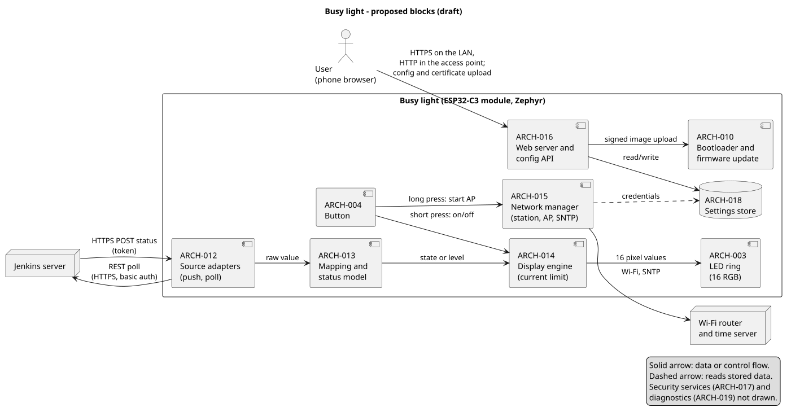

# 02 -- System design and alternatives (design doc)

- **Status:** Draft (Elephant draft; goldfish review RV-001 run on 2026-11-03: comprehension, three antagonistic passes and a readiness pass with verdict NO-GO, see section 9)
- **Date:** 2026-11-03  **Owner:** Ben Spoor
- **Area:** project (cross-domain: sw, hw, mech)
- **Requirements addressed:** SYS-001 to SYS-046 and SW-001 to SW-004 (all Draft), NEED-001 to NEED-019
- **EGM review record:** [RV-001](../reviews/RV-001-system-design-goldfish.md) (comprehension, three antagonistic passes and a readiness pass (NO-GO) were run, see RV-001)
- **Round log:** owner rounds 2 to 7 are folded in (rounds 2, 3, 5, 6 in sections 1a-1d; round 7 in section 10); no round 4 is recorded (round 4 = the single-module nRF/STM/Renesas questions in 4.2b). **Current platform: ESP32-C3 (round 6).** Text about nRF and RW612 in 4.2 to 4.2b, 4.14 and 7.6 is kept as the record of alternatives and for a later battery version; it is not the current plan. ADR drafts exist: ADR-0002 to ADR-0006 and ADR-0008 are Proposed, ADR-0007 was accepted and then set back to Proposed by the owner after review RV-001 (2026-11-03)
- **Nothing in this document is a decision.** Decisions are made in ADRs (section 8). Scores are first-pass judgement
  and must be replaced by evidence from the spikes in section 7. Cost, RAM, flash and current figures are **estimates
  from memory, not quotes or measurements**.

## 1. Problem definition
Design a Wi-Fi ring of 16 RGB LEDs that shows build or busy status from Jenkins (pushed and polled), is configured
through its own access point and a web page, updates over the air, and costs EUR 10-20 per assembled PCB at 10 units, in a
housing of about 53 mm. This document gives the proposed system structure, the real alternatives for each costly decision,
a recommendation, and the gaps found in the current requirements.

Out of scope: detailed schematics, firmware module design, housing shape, user manual text.

### 1d. Owner decision, round 6 (2026-11-03)
| Statement | Effect |
|-----------|--------|
| **Use ESP32-C3** | Platform for the first prototype and the production candidate. Supersedes the nRF start in 4.14 and the open cost question; the EUR 20 limit (SYS-021) stays. Spike 7.1 becomes the main spike. nRF (Fanstel single module) and RW612 remain options for a later battery version. ADR-0002 drafted (Proposed) |

### 1c. Owner decisions, round 5 (2026-11-03)
| Statement | Effect |
|-----------|--------|
| Volume later about 1000 units per year | Section 4.12 |
| Simulate as much as possible on the PC | Section 4.13, SYS-037 |
| Everything free and open source first | Proprietary simulators (Wokwi) are out of the required flow; open tools only: `native_sim`, BabbleSim, Renode, QEMU, west, KiCad, FreeCAD, PlantUML |
| Start with the best Zephyr-supported platform; Zephyr is important | Section 4.14: start on nRF5340 + nRF7002 (nRF7002 DK). Zephyr weight raised in the scoring |

### 1b. Owner decisions, round 3 (2026-11-03)
| Question | Owner answer | Effect |
|----------|--------------|--------|
| Platform | **nRF** | Option b: nRF now. The EUR 20 limit must be replaced by a new figure (open, question 1). ADR-0002 now compares nRF hosts (section 4.2a). Spike 7.6 becomes the main platform spike |
| Push stale timeout | Not relevant now, for later | superseded: SYS-033 is Must for push-only (RV-001 item 1). G2 stays open for a later release |
| WPA2-Enterprise | Do not add hardware limits that rule it out | New SYS-036 (headroom). Drives the choice of host chip and flash/RAM margin |
| Browser warning | Accepted at first | SYS-034 unchanged |
| Own certificate and key | Yes, the user can load them | New SYS-035 |

### 1a. Owner decisions, round 2 (2026-11-03)
| Question | Owner answer | Effect |
|----------|--------------|--------|
| Trusted LAN only? | Also shared networks | Plain HTTP on the LAN is out. New SYS-034; section 4.8 rewritten |
| Level (gauge) mode? | Yes, first release | New SYS-032 (closes G1) |
| Stale timeout for push? | 5 minutes | New SYS-033 (closes G2 in part, see section 5) |
| Short press may switch the ring off? | Yes | Recorded in assumption A8 (closes G9) |
| Platform | Prefers nRF | Evidence and cost check in section 4.2; **owner decision needed (section 10)** |
| Irreversible secure boot? | **Superseded 2026-11-03:** wanted before any unit leaves the owner (staged, ADR-0007). Earlier: not now; keep the door open. The first 10 units are prototypes, not for the field | Section 4.7: signed images from day 1, no fuses on prototypes, layout ready for later |
| Prototype shop | "Find the best quality and cost on your own" | Section 4.11 (research, no quotes yet) |

## 2. Design drivers and assumptions
| ID | Driver | Source |
|----|--------|--------|
| D1 | Cost at 10 units: fixed shop fees count as much as parts. Few part types, 2 layers, one side. **Later: about 1000 units per year (section 4.12)** | SYS-021, SYS-022 |
| D2 | Size: PCB about 46-48 mm across; Wi-Fi antenna must fit inside a ring of LEDs | SYS-028 |
| D3 | Firmware is Zephyr (project constraint) | CLAUDE.md |
| D4 | Flash and RAM for two image slots, TLS, web files, settings, 25 % free | SYS-026, SYS-029, SYS-030 |
| D5 | Security: unit password, signed updates, user CA upload, token, time for TLS | SYS-004, 013, 016, 029-031 |
| D6 | Program and test through USB-C only, no fixture | SYS-023 |
| D7 | Battery later without redesign of the core | NEED-015 |
| D8 | Logic runs on a host computer in CI | SYS-025 |
| D10 | Simulate as much as possible on a PC with open tools: native_sim, Renode, QEMU (section 4.13; Wokwi is excluded by round 5) | SYS-025, SYS-037 |
| D9 | EU market access: radio (RED) and cybersecurity (CRA) | `docs/regulatory/applicability.md` |

Assumptions (challenge these): **AS1** the LAN may be shared with untrusted users (owner, round 2); **AS2** the Wi-Fi network uses
WPA2/WPA3 personal in release 1 (WPA2-Enterprise is not in release 1, but SYS-036 keeps headroom for it; see gap G12); **AS3** one status source is active at a
time (A7); **AS4** the first 10 units stay with the owner and are not sold or given away (this keeps them out of "placing on the
market"; confirm with `regulatory-check`, this is guidance, not legal advice).

## 3. Proposed structure (recommended option A)

*Figure: proposed blocks. Source: [arch-system-blocks.puml](../diagrams/plantuml/arch-system-blocks.puml). The `ARCH-` IDs are proposed
and are registered as Draft in `docs/architecture/blocks.md`.*

**Data flow.** A source adapter (push listener or poller) produces a raw value. The mapping block turns it into a state
(or a level) with the user's table. An arbiter keeps the newest valid update and the age of the data. The display engine
renders 16 pixel values, applies the current limit, and sends them to the LEDs.

**Key structural rule.** Everything that is logic (status model, mapping table, JSON path extraction, arbiter, stale timer,
animation frames, current limiter, request parser) lives in a hardware-free C library `sw/app/src/core/` that builds and
runs on `native_sim`. Zephyr and driver code is a thin layer around it. This is what makes SYS-025 and fuzzing (SYS-005)
cheap. Adding a source (NEED-007) means adding one adapter that registers itself at build time.

| ARCH | Block | Domain | Parent requirements |
|------|-------|--------|---------------------|
| ARCH-001 | Power and USB-C input | HW | SYS-020 |
| ARCH-002 | Wi-Fi SoC module | HW | SYS-022, 023 |
| ARCH-003 | LED ring and LED data drive | HW | SYS-001, 028 |
| ARCH-004 | Button and test points | HW | SYS-017, 023 |
| ARCH-005 | Housing and light diffuser | MECH | SYS-028 |
| ARCH-010 | Bootloader and update (MCUboot) | SW | SYS-029 |
| ARCH-011 | Core runtime and event bus | SW | SYS-025, 027 |
| ARCH-012 | Source adapters (push, poll) | SW | SYS-003-007, 009, 010 |
| ARCH-013 | Mapping and status model | SW | SYS-002, 008 |
| ARCH-014 | Display engine and current limiter | SW | SYS-001, 018, 020 |
| ARCH-015 | Network manager (station, AP, SNTP) | SW | SYS-012, 031 |
| ARCH-016 | Web server, config API, static page | SW | SYS-014-016 |
| ARCH-017 | Security services (credentials, token, cert store, TLS) | SW | SYS-004, 013, 016, 030 |
| ARCH-018 | Settings store | SW | SYS-019 |
| ARCH-019 | Diagnostics (log, shell, self-test, identity) | SW | SYS-023, 024 |

See `blocks.md` for the current mapping.

## 4. Alternatives considered

### 4.1 Whole-system alternatives
| Option | Idea | Fits | Fails or costs |
|--------|------|------|----------------|
| **A. Single-SoC appliance** (recommended) | One Wi-Fi SoC module runs everything. Device polls and listens by itself | NEED-005, 006, 001, 009 | RAM and flash are tight with TLS plus Wi-Fi plus two slots |
| **B. Thin client plus bridge** | Device only speaks a simple protocol (MQTT or UDP). A small service on a server talks to Jenkins, maps data, sends colours | Smaller firmware, no TLS or CA upload on device, easy new sources | Needs an always-on server; NEED-006 says the device polls; NEED-018 loses its purpose; makers need a second thing to run |
| **C. MCU plus Wi-Fi co-processor** | Any Zephyr MCU runs the logic; a separate Wi-Fi chip (for example an ESP in AT mode) gives the network | MCU can be chosen for Zephyr maturity; RF part is pre-certified | Two chips, two flashes, more area and cost; soft-AP and TLS split across two images; fails D1 and D2 |
| **D. Two boards** (LED annulus plus centre board) | Ring board and compute board joined by a connector | Antenna and LED layout are decoupled | Two PCBs and a connector at 10 units; assembly by hand or extra cost |
| **E. Do nothing / existing products** | Use a ready busy light with a Jenkins plugin | Zero effort | Does not meet NEED-001/003/011/012 as stated; not an engineering project |

Option A is recommended because it is the only one that meets D1 and D2 together. B is the strongest challenge to A and is kept
as a documented fallback: if the spike (7.1) shows that TLS plus Wi-Fi does not fit the RAM margin, B removes the TLS client
and CA store from the device.

### 4.2 Platform: Wi-Fi SoC (ADR-0002 candidate)
Weights come from the drivers. Scores 1-5 (5 best) are judgement and unverified.

| Criterion (weight) | P1 ESP32-C3 module | P2 ESP32-C6 module | P3 ESP32-S3 module | P4 MCU + ESP-AT | P5 RP2040/2350 + CYW43 | P6 nRF7002 + nRF53 |
|--------------------|----|----|----|----|----|----|
| Unit cost at 10 (5) | 5 | 4 | 3 | 2 | 3 | 1 |
| Zephyr readiness: soft-AP, TLS, MCUboot, HTTP server (5) | 4 | 3 | 4 | 3 | 3 | 5 |
| Area and antenna fit (4) | 4 | 4 | 3 | 2 | 2 | 2 |
| Flash and RAM margin (4) | 3 | 4 | 5 | 4 | 4 | 5 |
| Shop availability, one side (4) | 5 | 4 | 4 | 3 | 2 | 3 |
| USB-C program and test without extra chip (3) | 5 | 5 | 5 | 3 | 5 | 4 |
| Radio pre-certified module (3) | 4 | 4 | 4 | 3 | 2 | 3 |
| Battery path later (2) | 4 | 4 | 3 | 4 | 3 | 5 |
| **Weighted total (max 150)** | **128** | **118** | **116** | **87** | **89** | **101** |

**Evidence on the owner's nRF preference (web search 2026-11-03; list prices for one piece, not 10-unit prices, not JLCPCB prices):**
- Wi-Fi comes from the nRF7002, a Wi-Fi-only companion chip, so an nRF design needs two parts: a host (for example nRF54L15) plus the nRF7002. A Raytac
  nRF7002 module is listed at about EUR 5.40 on [DigiKey](https://www.digikey.nl/en/products/detail/raytac/AN7002Q/25271279); nRF54L15 modules are
  listed at about USD 6.5-8.7 at [Mouser](https://www.mouser.in/en/c/embedded-solutions/wireless-rf-modules/bluetooth-modules-802151/?pg=4)
  (Fanstel). The two modules together are about EUR 12-14 before LEDs, board, assembly, shipping and duty, so the **EUR 20 limit
  (SYS-021) is very likely exceeded**; section 6 gives about EUR 21-31 per board for this option against about EUR 11-19 for ESP32-C3.
- Two modules also need about twice the area in a 30 mm free centre (D2) and probably two antennas. I found no sign that either module is in the JLCPCB
  parts library; if they are not, parts must be bought and shipped to the shop (cost and delay). Check this in spike 7.4.
- Nordic's [SoftAP documentation](https://nrfconnectdocs.nordicsemi.com/ncs/latest/nrf/protocols/wifi/sap_mode/sap.html) says: Wi-Fi 4 only, WPA2-personal only,
  one interface is either access point or station (not both), and the page documents one connected station (a phone, which is enough for provisioning).
  I could not confirm whether SoftAP is in upstream Zephyr or only in the nRF Connect SDK fork (this affects the west manifest pin and the licence of the
  Wi-Fi firmware blob). A [DevZone thread](https://devzone.nordicsemi.com/f/nordic-q-a/129374/wifi-softap-station-mode-in-one-compiled-image) reports that AP
  mode loses low-power mode on an nRF54 part; open question.
- What nRF genuinely gives: first-class Zephyr support, a hardware key store and secure boot path that suit the "allow for secure boot later" decision,
  a better route to the battery variant (NEED-015), and long-term support. These are real benefits for a regulated-style project (CRA).
- **Superseded by the owner (round 3): nRF is chosen.** The ESP32-C3 recommendation is withdrawn; ESP32-C3 stays only as a fallback if the nRF spike (7.6) fails. See 4.2a for the host chip. Superseded again by round 6: ESP32-C3 is the platform (ADR-0002).

Reading: P1 leads, but the gap to P2 (10 points) is mostly "Zephyr readiness" and cost. If a spike shows C6 Wi-Fi support in
Zephyr is equally mature, P2 becomes a serious option (Wi-Fi 6 and 802.15.4 give a future path). P6 has the best Zephyr
support and the worst cost: the nRF7002 alone is likely above the whole budget. P4 and P5 fail area and cost. **Outside the
project constraint:** the ESP-IDF or Arduino framework would be easier on P1 but violates D3; it is not scored.

### 4.2a nRF host chip (ADR-0002, now ready to draft)
Facts from web search 2026-11-03 (search snippets, not datasheets; verify before the ADR):
- nRF54L15: 1524 KB non-volatile memory (RRAM) and 256 KB RAM. Nordic's Matter guide asks for external flash of at least 1.5 MB for firmware
  updates on nRF5340 and nRF54L15, and mentions compressed updates as a way to avoid it ([Nordic](https://nrfconnectdocs.nordicsemi.com/ncs/latest/nrf/protocols/matter/getting_started/hw_requirements.html)).
- nRF5340: 1 MB flash and 512 KB RAM on the application core (from memory, unverified here). nRF5340 modules are listed at about USD 10 for one piece (retail listings).
  The nRF7002 kits are built around the nRF5340, so this is the best-documented pair.
- WPA2-Enterprise on nRF7002: Nordic staff say it is supported from nRF Connect SDK 3.0.0; users report EAP-TLS connection failures on 2.9.0 and 3.0.0 and an
  enterprise Wi-Fi sample image above 350 kB ([DevZone](https://devzone.nordicsemi.com/f/nordic-q-a/121864/can-t-get-wpa2-enterprise-eap-tls-to-connect-to-wifi-ap-using-nrf5340-nrf7002-ncs2-9-0/539761)).
  So SYS-036 is a real memory constraint and a software maturity risk, not a formality.
- nRF7002 is dual band (2.4 and 5 GHz), a plus on shared and company networks. 5 GHz adds regional rules (to check in `regulatory-check`).

| Host | Pros | Cons |
|------|------|------|
| H1 nRF54L15 + nRF7002 + external SPI NOR flash | Cheapest Nordic host, low power (battery later, NEED-015), hardware key store and secure boot path | Only 256 KB RAM for Wi-Fi, HTTPS server and client at once, and later WPA2-Enterprise: high risk; update needs external flash or compressed updates; reported loss of low power in AP mode |
| **H2 nRF5340 + nRF7002 + external SPI NOR flash** | 512 KB RAM; the pair Nordic documents best; external flash also holds certificates and web files; no hardware limit on SYS-036 | Higher module cost; second core idle; more power; larger |
| H3 nRF52840 + nRF7002 | Known part | 256 KB RAM like H1 with less security hardware; no advantage |

Updated by 4.2b: H2 is available as **one module (Fanstel WT02x40x)**, so the 'two modules' wording above is superseded; the external flash chip is still needed.

Recommendation: **H2**, with H1 kept as a cost-down for later if spike 7.6 shows that the memory fits in 256 KB with the WPA2-Enterprise headroom. It
is the only host that does not add a hardware limit against SYS-036 (owner round 3). One extra part (external flash, a small SPI NOR chip, usually a
basic library part) is needed in both cases. Cost estimate with H2: about EUR 25-35 per board (module prices from search, other items as in section 6),
so a new SYS-021 limit near EUR [35] is needed (question 1).

### 4.2b Single-module nRF, STM, Renesas and other Zephyr candidates (owner questions, 2026-11-03)
Web search, not datasheet review unless stated. Prices are one-piece list prices. Not checked at all: Infineon AIROC/PSoC, TI CC35xx, Microchip, Raspberry Pi RP2350 with Wi-Fi.

**1. Yes, one module with both nRF chips exists: Fanstel WT02x40x** (datasheet v0.99, Dec 2024, read in full for the points below):
nRF5340 (1 MB flash, 512 KB RAM) plus nRF7002 in one 14 mm wide, 2.0 mm thick module; crystals and DCDC inductors are inside, so no external parts are needed;
3.3 V; 16 castellated plus 45 LGA pads; QSPI pins are available for an external flash; Wi-Fi security listed as WPA3/WPA2/WPA personal **and enterprise**
(good for SYS-036); dual band; temperature -40 to +85 C; FCC ID and ISED ID given, "CE: compliant", but the same page also says certifications are "pending", so the
scope must be confirmed with Fanstel. Variants:

| Variant | Antennas (BLE / Wi-Fi) | Size mm (antenna area) |
|---------|------------------------|------------------------|
| WT02P40P | pads / pads (external antennas on our board) | 14 (15) x 18.5 |
| WT02E40E | u.FL / u.FL | 14 (15.5) x 23.0 |
| WT02E40C | chip / u.FL | 14 (15.5) x 24.5 |
| WT02C40C | chip / chip | 14 (25.0) x 24.8 |
| WT02V40V | chip / chip | 14 (16.4) x 30.5 |

Open: price and stock (not found at Mouser, DigiKey or LCSC in my searches), whether the shop can assemble it, and SoftAP in the SDK (same Nordic limits as 4.2).
It still needs an external flash chip for two image slots. **Effect:** this replaces "two modules" in H2 by one 14 x 18.5-25 mm part, which largely removes gap G15.
A pad-antenna variant (P40P) lets us place a small Wi-Fi antenna freely; a chip-antenna variant is easier but needs the keep-out.

**2. STM32.** STM32 has no Wi-Fi inside, so it is again a host plus a radio module. ST's own module is the ST67W611M1 (Qualcomm QCC743 radio, 32-pin LGA, SPI/AT control,
Wi-Fi 6 and BLE 5.4): about EUR 11.8 for one piece, ST quotes USD 6.66 at 10 000 pieces
([RS](https://ie.rs-online.com/web/p/microcontrollers/0480840), [ST](https://newsroom.st.com/?p=14413)). The module supports SoftAP, but **the Zephyr driver supports station mode only**
and a July 2026 [ST Community post](https://community.st.com/stm32-mcus-boards-and-hardware-tools-26/st67w611m1-roadmap-for-softap-mode-in-zephyr-driver-167182) asking for a SoftAP roadmap had no answer.
That fails SYS-012 unless we write the driver part ourselves. Not recommended now.

**3. Renesas.** The DA16200 (Wi-Fi SoC, USD 4.4) and DA16600 (Wi-Fi plus BLE module, about USD 10-16) are very low-power and are driven by Renesas' own SDK or AT commands over UART. I found
**no Zephyr Wi-Fi driver** for them, so Zephyr would only be a thin AT client, and TLS/AP behaviour would live in Renesas firmware we cannot review. Good for a battery product later; not
a fit for the "Zephyr, auditable" rule today.

**4. "ESP32 killer from a main brand with Zephyr support".** No chip beats ESP32 on price (module about EUR 2-3). Two come close on capability:
| Candidate | Evidence | Open points |
|-----------|----------|-------------|
| **NXP RW612** (Wi-Fi 6, BLE 5.4, 802.15.4, one chip) | In upstream Zephyr since 4.0 (FRDM-RW612 board; Wi-Fi shell sample; needs a binary blob fetched with `west blobs fetch hal_nxp`). Modules: u-blox IRIS-W106-00B about EUR 12.3 ([Mouser](https://www.mouser.in/new/u-blox/ublox-iris-w1-multiradio-modules/)), Murata Type 2FR about EUR 17.2. One module, one vendor, no second Wi-Fi chip | **SoftAP in upstream Zephyr not confirmed** (NXP's own SDK mentions Soft-AP and Soft-AP enterprise). RAM and flash from memory: large RAM, external flash needed; verify. Dev kit needed |
| **Silicon Labs SiWx917** (Wi-Fi 6, BLE 5.4, one chip) | Chip lists AP mode; Zephyr board exists, Wi-Fi support is marked Alpha; module SiWx917Y 16 x 21 x 2.3 mm with CE/FCC modular approvals | Zephyr SoftAP not confirmed; radio firmware must match the Zephyr release; price not found |

**Reading.** On price and area, the order is: ESP32-C3 (about EUR 2-3), RW612 module (about EUR 12), nRF Fanstel single module (price unknown, estimate above EUR 12), anything with two modules.
On "Zephyr mainline with a big vendor", RW612 and nRF are the leaders, nRF with the best SoftAP documentation. **Recommendation:** run the platform spike (7.6) on two parts,
**Fanstel WT02P40P or WT02E40E** (your nRF preference, one module) and **an RW612 module** (the only single-chip Wi-Fi candidate in upstream Zephyr),
and keep ESP32-C3 as the cost fallback. The deciding tests are SoftAP with WPA2, HTTPS server plus client at the same time, signed update with external flash, and
price at 10 units.

### 4.3 Antenna and board topology (ADR-0003 candidate)
A 13 x 17 mm module with an on-board antenna needs clear space (no copper, no LEDs, no metal) around the antenna, and LEDs
must stay evenly spaced (SYS-028). USB-C shell and button also need edge space.

| Option | Description | Pros | Cons and risks |
|--------|-------------|------|----------------|
| T1 Module in the centre, antenna end toward the free edge | Module inside the 30 mm free centre, antenna facing away from USB-C, copper keep-out under and around it | One board, one side, cheapest, pre-certified module | Antenna surrounded by LED ring and tracks: range and detuning unknown. Only a measurement shows it works |
| T2 Module with external antenna connector plus small antenna on the housing wall | Variant of the module with u.FL connector | Good antenna placement; no keep-out inside the ring | Extra connector and antenna part; cable step is manual assembly (plugging in a cable is not soldering, so it does not conflict with SYS-022 if that rule means "no soldering"; owner to confirm, ADR-0003); mechanical fixing needed |
| T3 Bare SoC plus chip antenna | Own RF section | Smallest, cheapest parts | RF matching and tuning need lab equipment; module certification does not carry over (RED effort); highest risk at 10 units |
| T4 Two stacked boards | Ring board above compute board | Antenna and LEDs in separate layers | Second PCB, connector, thickness; cost |

**Reopened by round 3.** (nRF-era record; current order is in ADR-0003: A, then B, then D.) Two modules (host and nRF7002) plus an external flash chip need much more area than one ESP32 module in the 30 mm free centre, and
each module has its own antenna keep-out. I have not found the dimensions in the sources, so T1 is unproven. The higher cost limit makes T4 (stacked boards) more
acceptable than before. Order of attempts: T1 with the real module outlines in KiCad, then T4, then a housing up to 58 mm (the top of the SYS-028 tolerance).

**Current position: see ADR-0003 (A first, B as fallback, then D).** The text below is the earlier recommendation, kept as a record. Original recommendation (ESP32 era): **T1**, with T2 as the fallback if the spike (7.2) shows poor range. T3 is rejected for the first release
(RF and RED risk, no benefit that is needed at 10 units). T4 is rejected unless T1 and T2 both fail.

### 4.4 LED type and data drive (ADR-0004 candidate)
| Option | Pros | Cons |
|--------|------|------|
| L1 Addressable single-wire RGB LED in a 2020 or 3535 package (WS2812-type, SK6812-type) | One data line, 16 LEDs in a chain, low part count, common in prototype shop libraries | 3.3 V data into a 5 V LED may be below the input threshold (gap G14); timing-critical; no hardware current limit, so firmware must limit current |
| L2 Clocked addressable LED (APA102-type) | Tolerant timing, SPI-friendly | Higher cost, needs two data lines, more parts |
| L3 Discrete RGB LEDs plus a constant-current driver IC | Hardware current control, no timing problem | More parts and cost, needs an I2C or SPI driver chip and resistors; fails D1 |

Recommendation: **L1**, with a level shifter or a lowered LED supply decided by a SPICE and timing check (7.3). Firmware
current limiting is mandatory and is a safety function (RISK to be written).

### 4.5 Provisioning channel (ADR-0006 candidate)
| Option | Pros | Cons |
|--------|------|------|
| V1 Soft-AP plus web page (as in NEED-001) | Works on every phone, no app, matches the needs | Phone may show "no Internet" warning; captive portal needs a small DNS responder |
| V2 BLE provisioning from a web page | No temporary Wi-Fi network | Browser support is uneven (not on iOS Safari); extra stack in flash; fails NEED-016 |
| V3 USB serial only | Simple | Not usable by non-technical users; fails NEED-001 |
| V4 Vendor smart-config (broadcast of Wi-Fi password) | Quick | Weak security; vendor lock-in |

Recommendation: **V1**. V3 stays as the production and recovery path.

### 4.6 Unit password for the access point (ADR-0006 candidate)
| Option | Pros | Cons |
|--------|------|------|
| W1 Random passphrase created in the production step (for example 16 characters from a 32-character set, 80 bits), stored in a protected settings area, printed on a label | Unique, cannot be derived from SSID or MAC; simple to verify | Label must be handled; a user who builds from the open files needs the same tool (`scripts/provision.*`, to be written) |
| W2 Derived from a secret in the chip's one-time fuses and the MAC | No password file per unit | User still needs the value, so a label or a tool anyway; fuse use is irreversible |
| W3 Open AP plus an application-level pairing code (PAKE) | No Wi-Fi password to print | Wi-Fi layer is unencrypted; complex to implement and review; fails SYS-013 wording |
| W4 Same password for all units | Trivial | Fails NEED-019 and SYS-013 |

Recommendation: **W1**. Open point: reset to factory must keep the passphrase (it identifies the unit).

### 4.7 Update and boot security (ADR-0007 candidate)
| Option | Pros | Cons |
|--------|------|------|
| U1 MCUboot, two slots, signature check, upload through the web page | Standard, auditable, rollback; no server to run | Two slots halve the usable flash; needs a signing-key plan |
| U2 Pull from a release URL over HTTPS | Easy for users | Needs a server, certificates and time; larger attack surface; ties project to hosting |
| U3 U1 plus the SoC's secure boot and flash encryption (fuses) | Strong against physical attack; supports CRA arguments | Irreversible; a mistake bricks units; makes production and recovery harder |
| U4 No bootloader, single image overwritten | Biggest free flash | Fails SYS-029 (power loss bricks the device) |

Recommendation (updated 2026-11-03 for the owner's wish for secure boot and flash encryption; see ADR-0007): **U3, staged.** Stage 1 is U1 with no fuses on the 10 internal prototypes;
stage 2 proves the fuse procedure on sacrificial boards; stage 3 sets secure boot and flash encryption on every unit before it leaves the owner. The Espressif bootloader is the fallback. The text below is the earlier record. To keep the door open: sign every image from day 1 with a **development key
that is clearly marked and never used for a release**; keep the partition layout compatible with later flash encryption
(no raw secrets in flash); keep the unit passphrase in a block that can be moved to protected storage; write the key-management
document (G8) before any unit leaves the owner. U2 is a later addition behind the same slot layout.

### 4.8 Transport protection for web page and push (ADR-0008 candidate)
This is the most important open security choice because SYS-016 and SYS-004 send a password and a token over the LAN.

| Option | Pros | Cons |
|--------|------|------|
| X1 Plain HTTP; web password and push token in clear (as SYS-004/016 read today) | Smallest, no certificate handling | Anyone on the LAN can read the password and token and replay requests |
| X2 HTTP for push with a signed request (HMAC with shared key, time stamp, counter); web page on HTTP | Token is never sent; replay limited | Needs time (SYS-031) or a counter; Jenkins side needs a script, not a stock plug-in; web password still in clear |
| X3 HTTPS for both, with a per-device self-signed certificate created on first start | Strongest | Browser warnings (hurts NEED-016); each client must trust the device certificate; TLS server RAM and flash; certificate lifecycle |
| X4 Web page on HTTP only inside the provisioning AP (WPA-encrypted), HTTPS or X2 on the LAN | Provisioning is protected by the Wi-Fi layer; LAN risk is limited to token | Two modes to test |

**Updated after owner round 2 (shared networks):** X1 and X2 are rejected, because the web password would still cross the LAN in
clear. Recommendation: **X4 with X3 on the LAN.** Inside the provisioning access point the page is plain HTTP, protected by the
WPA2 unit passphrase. On the LAN, both the web page and the push endpoint use HTTPS with a key pair that the device creates at
first start (SYS-034). The page shows the certificate fingerprint. Jenkins pins that fingerprint (for example `curl --pinnedpubkey`)
so that no public CA is needed. SYS-035: the user can load a certificate chain and key (through the AP or the authenticated interface).
Costs accepted: a browser warning at first use (hurts NEED-016, to be handled in the manual and by showing the fingerprint),
and TLS server plus TLS client in RAM at the same time. Spike 7.1 must measure that RAM use on the ESP32-C3.

### 4.9 Mapping model (ADR-0005 candidate)
| Option | Pros | Cons |
|--------|------|------|
| M1 Path to a value in the JSON response plus an editable value-to-state table (as SYS-006/008) | Small, testable, safe, enough for Jenkins and many APIs | Cannot combine fields or compute levels |
| M2 Small expression language (comparisons, arithmetic) | Handles levels and thresholds | New language to specify, fuzz and secure; larger code |
| M3 One hard-coded parser per source | Smallest per source | Every new source needs firmware change; breaks NEED-007 |
| M4 Embedded scripting (Lua, WASM) | Most flexible | Large flash and RAM cost; attack surface; hard to certify |

Recommendation: **M1 for the first release, with the interface (`map_value() -> state, level`) designed so that M2 can replace
it.** M4 is rejected on resource and security grounds. Note: Zephyr's built-in JSON library needs a fixed structure
description, so a small generic path extractor must be written and fuzzed (cost to include in the plan).

### 4.11 Prototype shop (research 2026-11-03, no quotes yet)
Shop rules from the needs: assembly on one side, parts from the shop's own list, few part types, 10 units (SYS-021, SYS-022).

| Option | What I found | Fit |
|--------|--------------|-----|
| **J. JLCPCB Economic PCBA** | Economic set-up fee about USD 8; one side only; USD 3 fee per extended part, preferred extended parts exempt on Economic ([JLCPCB FAQ](https://jlcpcb.com/help/article/98-pcb-assembly-faqs)). Cheapest in the sources; forum posters rate its quality and finish well | Best match to one-side, 10 units, few part types. Design the BOM from basic and preferred parts; the module and USB-C connector will probably be extended parts |
| P. PCBWay | More flexible and more human support; usually a little dearer (vendor-affiliated and forum sources, treat as directional) | Good second quote, and fallback if J rejects a part |
| E. European shop (for example Aisler) | EU production, no customs, quick delivery inside the EU; forum reports say 3-4 times the price of JLCPCB | Only if duty and delay on imports prove worse than the price gap |

EU import rules changed on 1 July 2026: the low-value duty exemption was removed, with a fixed duty of about EUR 3 per customs
line, plus VAT, for shipments under EUR 150 ([JLCPCB notice](https://jlcpcb.com/news/eu-customs-reform-2026), sources disagree on who collects it;
verify at checkout). That affects all non-EU shops equally and is now in the cost estimate.

Recommendation: **J (JLCPCB Economic PCBA) as primary, a PCBWay quote for comparison.** "Best quality" cannot be settled from
forum anecdotes. The decision rule is: identical BOM and files, quotes from J and P with delivery to your address and landed
cost per board, then choose the lower cost unless the shop's DFM check or parts list fails. Spike 7.4 does this.

### 4.10 Software structure and persistence
- **Structure:** S1 event-driven Zephyr threads with message passing between blocks (recommended) versus S2 one thread per source
  with shared state (simpler, harder to test and to reason about races). Recommendation S1.
- **Settings:** Zephyr settings on NVS (power-loss safe, wear levelling, recommended) versus a file system (more flash, more code).
- **Time when there is no NTP** (G7): recommend adding "take the time from the browser" as a fallback on the web page, so that
  an isolated network with a private CA still works.

### 4.14 Start platform: best Zephyr support (round 5)
**Superseded by round 6: the owner chose ESP32-C3.** The text below stays as the record of the nRF analysis and is the starting point for a later battery version.

What the evidence says about "best supported in Zephyr" (search snippets; verify against the Zephyr tree before the ADR):
- **nRF7002 DK** (nRF5340 plus nRF7002) is an upstream Zephyr board ([docs](https://docs.zephyrproject.org/latest/boards/nordic/nrf7002dk/doc/index.html)); the nRF70 Wi-Fi driver was added upstream in Zephyr 4.0; `nrf5340bsim` is an upstream simulated target; Nordic documents a **SoftAP sample** and security modes, in the nRF Connect SDK
  ([sample](https://nrfconnectdocs.nordicsemi.com/ncs/latest/nrf/samples/wifi/softap/README.html)). **Not confirmed: that SoftAP and enterprise Wi-Fi are in upstream Zephyr** and not only in the NCS fork.
- **ESP32-C3** has been production-ready in upstream Zephyr since 4.0 ([Espressif](https://developer.espressif.com/software/zephyr-support-status/)) and the 4.0 release notes list station-plus-AP support for its Wi-Fi driver. Its support is thinner in documentation and samples, and its Wi-Fi is a binary library from Espressif.
- RW612 and SiWx917 are upstream boards with Wi-Fi at an earlier stage; STM32 Wi-Fi in Zephyr is station-only for the ST module; Renesas has none.
- **No Wi-Fi chip has open firmware.** nRF70, ESP32, RW612 all load binary blobs. "Open source first" therefore means our code, the SDK, the tools and the simulators; the blob licence must be checked for redistribution (G16).

**Decision rule for "best".** Both nRF70 and ESP32 are in mainline Zephyr, so the difference in Zephyr support is smaller than the difference in price. By documentation, samples, vendor engagement and the simulated board, **nRF5340 + nRF7002 is the best-supported Wi-Fi platform I found**.

**Recommended start (consistent with your rounds 3 and 5):**
1. Start software on the **nRF7002 DK** (about EUR 62-67 ex VAT) with `native_sim` and `nrf5340bsim` for the PC layers L0-L2 and the DK for L3. Work against the hardware interfaces of 4.13 so that nothing in `core/` depends on the chip.
2. Use the nRF Connect SDK (Apache-2.0 licensed, Nordic's Zephyr distribution) pinned in the west manifest while SoftAP and enterprise Wi-Fi are not confirmed upstream, and track upstream Zephyr. A written ADR records this (G16).
3. Keep ESP32-C3 as a **cost check**, not as the start: a one-week spike on a EUR 10 dev kit answers whether the 1000-unit saving of EUR 8-14k per year is worth switching.
4. The hardware decision (Fanstel single module, separate modules, or ESP32) stays at the 1000-unit quote gate (4.12). Cost remains the open risk: the nRF design is estimated at EUR 25-35 per board (question 1).

### 4.12 Volume scenario: about 1000 units per year later (owner, 2026-11-03)
At 10 units fixed shop fees dominate. At 1000 units per year they almost vanish, and **other costs become as large as the chip price**. All figures below are
**my estimates from memory and search, not quotes**; they show the structure of the decision, not its answer.

| Cost item, per year at 1000 units | Rough size | Why it matters |
|-----------------------------------|-----------|----------------|
| Compute module price difference: ESP32 class vs nRF or RW612 class | about EUR 8-14 per unit, so **EUR 8-14k** | The only item that favours ESP32 clearly |
| Radio, EMC, safety and cyber test of the finished product (pre-certified module assumed) | one-off, perhaps EUR 8-20k | Same for any platform; larger if a module is not pre-certified or uses 5 GHz |
| Engineering time for Wi-Fi, HTTPS, provisioning and OTA on Zephyr | one engineer-month is about EUR 8-12k | Platform maturity can cost or save several months |
| Vulnerability handling, SBOM and security updates for the support period (CRA, default 5 years) | a fraction of one engineer, every year | Same for any platform; easier with a hardware key store and a well-documented SDK |
| Production: programming, per-unit passphrase and label, self-test, returns | per-unit minutes plus a fixture | Needs a provisioning tool and test fixture (SYS-013, SYS-023) |

**What changes with this volume**
1. From the first sale, the product is **placed on the market**: RED (radio, cyber), RoHS, WEEE, GPSR and the CRA apply to you as manufacturer. The first 10 units stay out only if they stay with you
   (AS4). `docs/regulatory/applicability.md` is updated. Guidance, not legal advice; CRA dates and class must be checked.
2. The 10-unit cost test in SYS-021 is the wrong test for production. Proposal (not yet in the requirements): keep it for the prototype run and add a **bill-of-materials target at 1000 units** after quotes at that volume.
3. The platform choice is no longer decided by chip price alone. The module difference of EUR 8-14k per year is about one engineer-month or one test round **per year**; a platform that saves several months of integration, or lowers vulnerability work, can
   pay back within a year or two. A platform with a small vendor (Fanstel) or a single source is a supply risk at 1000 per year; big-vendor modules (Espressif, u-blox, Murata) are safer.
4. The signing-key process (G8), a per-unit provisioning tool, a production test fixture, a return process and a support promise become real work items, not footnotes.
5. The prototype shop is fine for the first runs; at 1000 per year a quote from a European contract manufacturer should be compared (duty, lead time, quality control).

**Superseded by owner round 6 (ESP32-C3) and ADR-0002; kept as a record. Business case deferred (round 7).** Revised recommendation. Do **not** choose the production platform now. Choose it at a gate with quotes at 1000 units, after the spikes. Until then:
(a) build the software on a thin hardware layer so that the platform can change; (b) spike ESP32-C3 (cheapest, 7.1), Fanstel nRF (your preference, 7.6) and RW612 (7.6) on the same four tests; (c) compare them on three-year
cost per unit (module price, certification share, engineering months, support effort, supply risk). On cost alone ESP32 still wins by a wide margin; the nRF choice is justified only if it saves roughly one to two engineer-months or the
battery version is a near-term plan.

### 4.13 Simulation on the PC and its effect on the platform (owner wish, 2026-11-03)
Evidence (web search 2026-11-03, snippets, not tried by me):

| Simulator | What it covers | Limits found |
|-----------|----------------|--------------|
| Zephyr `native_sim` (open source) | Whole application as a Linux process; host sockets; ztest; fuzzing | Not a chip. A native Wi-Fi driver exists that **uses the PC's Wi-Fi as a station** ([binding](https://docs.zephyrproject.org/latest/build/dts/api/bindings/wifi/zephyr%2Cnative-sim-wifi.html)); an emulated Wi-Fi medium is only draft pull requests, **station side only, AP not covered** ([RFC](https://github.com/zephyrproject-rtos/zephyr/discussions/111334)) |
| Wokwi (proprietary, online or VS Code) — **excluded by the owner's open-source-first rule (round 5)** | ESP32, C3, S2, S3, C6, H2 and others in one simulator ([docs](https://docs.wokwi.com/guides/esp32)); Wi-Fi through a gateway; GDB; I have seen NeoPixel ring parts there (not verified for this project) | Some peripherals partial (RMT, TWAI). **Private gateway is for paying users** ([Wi-Fi guide](https://docs.wokwi.com/guides/esp32-wifi)). Not confirmed that Wi-Fi works with a **Zephyr** image. No nRF5340/nRF7002 or RW612 found. Proprietary service as a CI dependency conflicts with an open, reproducible project (NEED-012, SYS-024) unless a free fallback exists |
| Renode (open source) | nRF52840 with Zephyr is published and tested ([Antmicro](https://github.com/antmicro/renode-zephyr-nrf52840)) | I found **no confirmation of nRF5340, nRF54L15, ESP32-C3 or RW612 models, and no Wi-Fi model**. nRF7002 firmware is a closed binary on a separate chip |
| QEMU (Espressif fork) | ESP32, S3, C3, C6 run Zephyr ([Espressif blog](https://developer.espressif.com/blog/2026/09/zephyr-espressif-qemu-hello-world/)); emulated Ethernet for network tests | **Wi-Fi and Bluetooth are not emulated** ([README](https://github.com/espressif/esp-toolchain-docs/blob/main/qemu/README.md)); Espressif gives no support for QEMU |

**Honest result: no platform lets you simulate the real Wi-Fi radio or the SoftAP on a PC.** Wi-Fi association, SoftAP, RF range and radio timing are verified on hardware for every
candidate. The platforms differ in how much *else* runs in a simulator:

| Platform | PC simulation coverage (judgement, 1-5) | Why |
|----------|-------------------------------------------|-----|
| ESP32-C3 / C6 / S3 | 4 | QEMU plus native_sim (Wokwi excluded by round 5); no Wi-Fi in either |
| nRF5340 + nRF7002 (also nRF54L15) | 2 | native_sim only for sure; Renode proven for nRF52840 only; nRF7002 cannot be modelled |
| NXP RW612 | 1 | Nothing found |
| STM32 + ST67W611 | 2 | STM32 cores are commonly simulated (from memory), the radio module is not |
| Renesas DA16xxx | 1 | Nothing found |

Adding this criterion with weight 4 to the table in 4.2 gives totals (maximum 170): ESP32-C3 144, ESP32-C6 134, ESP32-S3 132, nRF7002 + nRF5340 about 109, MCU plus ESP-AT 99, RP2040 + CYW43 97.
The ranking does not change, but the ESP32 lead grows. Scores are judgement.

**Design rule that makes the platform less important (adopted into the structure in section 3).** Everything is built behind small interfaces, each with a real and a simulated implementation:
`wifi_if` (station/AP events and sockets), `led_sink` (16 pixels), `button`, `storage` (flash with power-cut injection), `clock`. Test layers:

| Layer | Runs on | Covers | Does not cover |
|-------|---------|--------|----------------|
| L0 unit | `native_sim`, ztest | `core/` logic, parsers, mapping, arbiter, current limiter, animation frames | Hardware |
| L1 component | `native_sim` with host sockets | HTTPS server and client, token and password checks, fuzzing (SYS-005), certificate upload, TLS with a test CA | Radio, real heap and timing |
| L2 firmware-in-simulator | Renode or QEMU, if the platform has a model | Boot, settings, button timing, LED frame capture, power-cut injection for the settings layer (SYS-019). A real MCUboot swap and ESP32 flash behaviour (partial erase, alignment) are **not** shown by `native_sim` or QEMU; they need a power-cut rig on real hardware (RV-001) | Wi-Fi, RF |
| L3 hardware-in-the-loop | Dev kit on a bench PC or CI runner, one per candidate platform | Wi-Fi, SoftAP and phone provisioning, range, current, LED drive timing, OTA over the air | Nothing: this is the ground truth |

New requirement drafted: SYS-037 (simulation). For a CI hardware-in-the-loop runner an ESP32 dev kit costs about EUR 10; nRF7002 kits cost about EUR 60-70 each (section 7.6).
A proprietary simulator must not be the only gate (SYS-024: reproducible, open tools).

**Re-scored under the round 5 rules (open tools only, Zephyr important).** Without Wokwi, ESP32 keeps QEMU (no Wi-Fi) and `native_sim`. The nRF5340 has an **upstream simulated board,
`nrf5340bsim`** (BabbleSim; radio, UART, timer, GPIO, IPC and others modelled; no TrustZone; BLE radio, **not Wi-Fi**; both cores can be combined into one executable)
([Zephyr docs](https://docs.zephyrproject.org/latest/boards/native/nrf_bsim/doc/nrf5340bsim.html)). I still found no Renode model for the nRF5340. So simulation coverage is about equal: ESP32 3, nRF5340 3, RW612 1.
Weights: simulation 4, Zephyr readiness raised from 5 to 8. New totals (maximum 185): ESP32-C3 152, ESP32-C6 139, ESP32-S3 140, nRF5340 + nRF7002 128, RP2040 + CYW43 106, MCU + ESP-AT 104. **ESP32-C3 still leads**, because the matrix is
dominated by cost, area and shop availability; the Zephyr criterion alone favours nRF by one point. Scores are judgement. The simulation advantage of ESP32 mostly disappears under the open-source rule.

**Effect on the recommendation (before round 5).** Simulation favoured ESP32 again, and it matters most for the safety-relevant tests (power-loss during update and settings writes), which
are cheap in a simulator and awkward on a bench. It does not decide the platform alone, because L3 stays mandatory. If nRF is kept, plan more L1 effort (native_sim carries more) and one
hardware-in-the-loop rig early.

## 5. Gaps and risks found in the current requirements (critical review)
| # | Finding | Severity | Proposal |
|---|---------|----------|----------|
| G1 | NEED-004 asks for **levels** but no SYS requirement showed one | High | **Closed by owner answer: SYS-032 drafted** (needs owner approval) |
| G2 | SYS-010 detects stale data only for polls. With push only, a Jenkins that stops sending leaves the ring green forever | High | SYS-033 drafted with 5 min. **New problem:** Jenkins sends events only at build start and end, so a quiet Jenkins is normal for hours. A 5 min timeout works only if the sender also sends a heartbeat (for example a cron job every minute), or if the device polls. SYS-033 (Must) with the heartbeat of SYS-040 |
| G3 | SYS-016 and SYS-004 send password and token in clear (section 4.8) | High | SYS-034 drafted (TLS on the LAN); ADR-0008 to confirm |
| G4 | Power: 16 LEDs at full white are about 0.9-1 A (estimate). SYS-020 limits **total** to 500 mA, and Wi-Fi transmit peaks use a large part of it (verify in datasheet). The LED share may be only about 150-250 mA, a few tens of percent of full white | High | Power budget analysis in `hw/sim/` before SYS-001's "visible at 2 m" is accepted; make brightness a measured requirement |
| G5 | SYS-023 self-test "checks the LEDs", but no sensor sees them | Medium | Define as "operator confirms by eye", or add an optical sensor (cost) |
| G6 | SYS-029 two slots plus SYS-026 25 % free: slot size and image size are not budgeted | Medium | Flash and RAM budget table from spike 7.1. Paper budget done: `spike-7-1-e2a-flash-budget.md` (break-even about 1.31 MiB at the 75 % rule); measured budget E2b pending |
| G7 | SYS-031: no NTP on isolated networks makes private-CA HTTPS impossible | Medium | Time from the browser as fallback (4.10) |
| G8 | Update-signing key plan, loss and rotation | High (process) | Risk entry and key-management document before first release; draft exists: `docs/regulatory/technical-file/05-cybersecurity/key-management.md`, RISK-006 |
| G9 | SYS-017: short press switches the ring off; an off ring hides a failing build | Low | Owner accepted. Suggest (not decided): a failure or stale state while off shows one dim LED |
| G10 | Thermal: up to about 2.5 W inside a 53 mm printed shell (PLA softens near 55-60 C, estimate) | Medium | Thermal analysis, material choice in `mech/analysis/` |
| G11 | Photobiological safety of a bright LED ring (EN 62471) not assessed | Medium | Part of regulatory check, with LED selection |
| G12 | WPA2-Enterprise and captive-portal networks (common in companies running Jenkins) are not supported by the plan. Shared networks make this more likely to matter | Medium | See SYS-036, E12 |
| G13 | Push address needs a stable name (for example mDNS) so Jenkins does not break when the IP changes | Low | Draft a requirement for a host name |
| G14 | 3.3 V data to a 5 V LED may fail the input threshold | Medium | Level check in 7.3 |
| G15 | A host module plus a Wi-Fi module plus flash must fit the ring centre (T1). **Smaller if the single Fanstel module (14 x 18.5-25 mm) is used** | High | Place real outlines in KiCad (owner makes CAD changes); fall back to T4 or up to 58 mm. nRF-era, superseded by round 6 |
| G16 | nRF Connect SDK is Nordic's Zephyr fork; SoftAP, enterprise Wi-Fi and the Wi-Fi firmware blob licence may differ from upstream Zephyr | Medium | ADR on west manifest (NCS or upstream), licence check for NEED-012. nRF-era, superseded by round 6 |
| G17 | WPA2-Enterprise EAP-TLS has open user reports of failure on NCS 2.9/3.0 | Medium | Include an enterprise build in spike 7.6 to measure size; not a first-release feature. nRF-era, superseded by round 6 |

## 6. Non-functional view (checklist, process section 5)
- **Testability:** `core/` runs on host; endpoint fuzz on `native_sim`; target shell over USB gives self-test (`selftest`, `identity`); test pads for 3V3, GND, reset and boot select.
- **Auditability:** version, git describe and hardware revision reported (SYS-024); signed images; reproducible build pinned by the west manifest.
- **Safety:** current limiter in `core/` with unit tests; watchdog (SYS-027); state unknown at start (SYS-011); thermal and photobiological analysis (G10, G11).
- **Security:** attack surface is the web server, the push listener and the update upload; each gets a size limit, rate limit and fuzz test; secrets are never logged; open items G3, G8.
- **Resources:** budgets are unknown until spike 7.1 (G6). **Estimate only:** a Zephyr image with Wi-Fi, TLS and web server may need 1.0-1.5 MB flash; this is the key feasibility question for a 4 MB part with two slots. Paper budget done: `spike-7-1-e2a-flash-budget.md` (break-even about 1.31 MiB at the 75 % rule); measured budget E2b pending.
- **Regulatory (guidance, not legal advice):** a radio is intentionally emitted, so RED applies; cybersecurity essential requirements (RED delegated act and EN 18031 family, CRA) shape G3, G8 and the update support period. A pre-certified module helps the radio argument but the finished device still needs its own tests. Update `docs/regulatory/compliance-matrix.md` when choices are accepted. No claim of compliance is made.
- **Cost (hypothesis, not a quote):** module about EUR 2-3, 16 LEDs about EUR 1-2.5, other parts about EUR 1, bare board and assembly fees spread over 10 about EUR 5-9, shipping and tax about EUR 2-4. Add about EUR 0.3 per board for the new EU duty (one line of EUR 3 over 10 boards, if a single customs line). That sums to roughly EUR 11-19 for the ESP32-C3 design: inside the limit but with little margin. With the nRF host that was chosen in round 3 and superseded in round 6 (H2: nRF5340 module about USD 10, nRF7002 module about EUR 5.4, external flash about EUR 0.3-0.5, more LED and board area) the estimate is roughly EUR 25-35, above the old limit of EUR 20. A real quote is gate 7.4.

## 7. Spikes and analyses (to answer before ADRs are accepted)
Spikes live on branches `spike/*` and are never merged. Hardware changes need the owner to edit CAD files.
| # | Question | Method | Result goes to |
|---|----------|--------|----------------|
| 7.1 (main, first) | Does Zephyr on ESP32-C3 give soft-AP with WPA2, HTTP server, TLS poll with a user CA, MCUboot with signed swap, and how much flash and RAM does it use? | Dev kit, `west build`, measure `size` and heap. **Gate with numbers (RV-001):** per-slot image size and flash left against the paper budget (two slots, bootloader, settings, certificates, passphrase, web files, 25 % margin, EAP headroom); free heap with TLS server, TLS client and an update upload at once; AP and station together or not; no corrupted LED frames during Wi-Fi traffic and an update; time of a TLS push handshake; ECDSA key creation time; MCUboot swap time. If the budget fails: smaller image, a larger-flash module (no official 8 MB ESP32-C3-MINI-1 found; ESP32-C3-WROOM-02-N8 is bigger, see RV-001 item 3), or a different platform. Effort cap per missing Zephyr feature: [2] weeks, then escalate to the owner | ADR-0002, 0007, 0008 |
| 7.2 | Does the module's antenna work in the centre of an LED ring? | Test board or dev module with a mock ring: signal strength at fixed distances versus a bare module | ADR-0003 |
| 7.3 | Does 3.3 V data drive the chosen LED at 5 V and at a lowered supply? | ngspice and a breadboard test | ADR-0004 |
| 7.4 | Real cost of a draft BOM at 10 units, and whether the module are in the shop library | Identical-spec quotes from JLCPCB Economic and PCBWay, landed at your address | SYS-021, ADR-0002, section 4.11 |
| 7.5 | Power budget: Wi-Fi peak plus LEDs on a USB source | Spreadsheet or script in `hw/sim/`, then bench measurement | G4, SYS-020 |
| 7.6 (later: battery version only) | Does the platform fit? Candidates: Fanstel WT02P40P/E40E (nRF5340 + nRF7002 in one module) and an NXP RW612 module (u-blox IRIS-W106). On nRF5340 DK plus nRF7002 EK first, then nRF54L15 DK plus nRF7002 EB II: SoftAP with WPA2, station, HTTPS server and HTTPS client together, user CA and own certificate, MCUboot with external flash, and a build with EAP-TLS. Compare upstream Zephyr with the nRF Connect SDK | Two kits (about EUR 60-70 each), `west build`, measure flash, RAM, free heap | ADR-0002, 0007, 0008, SYS-036 |

## 8. Plan of record (what follows this document)
1. Owner answers the open questions in section 10 and approves or edits SYS-032, SYS-033 and SYS-034 (all Draft).
2. Draft ADRs, in this order (drafted 2026-11-03; ADR-0002 platform, ADR-0003, ADR-0004, ADR-0005, ADR-0006, ADR-0007 and ADR-0008 are all Proposed; ADR-0007 was set back from Accepted by the owner after RV-001), each with the alternatives above: ADR-0002 platform, ADR-0003 antenna and board topology, ADR-0008 transport protection, ADR-0006 provisioning and unit password, ADR-0007 update and boot security, ADR-0005 mapping model, ADR-0004 LED drive. ADR numbers are proposed; ADR-0001 exists.
3. Done (2026-11-03): remaining requirements from section 5 drafted (SYS-001 brightness, SYS-042 host name); owner approval is open. SYS-032 to SYS-034 are already drafted.
4. Done (2026-11-03): `docs/risk/risk-register.md` entries RISK-001..022 written.
5. Done (2026-11-03): ARCH-001..019 registered; HW-001..009, SW-001..004 and MECH-001..006 written. Open: owner approvals and increment plans (03 and later). Only then does implementation start.

Order of build increments (indicative, for planning): (1) `core/` library and host tests; (2) display engine and LED driver on a dev kit; (3) network manager, web server, provisioning; (4) sources; (5) update path; (6) custom board; (7) housing.

## 9. Review status
Section 10 has no open question that blocks the ADRs or spike 7.1, and the ADR drafts exist, so the Goldfish protocol is run now.
The comprehension pass was run on 2026-11-03; it matched the intended design but found stale nRF-era text and inconsistent counts, now corrected. The antagonistic and readiness passes were run; see RV-001.
A readiness pass on this system-level design may return NO-GO for implementation by design; that result is recorded, not hidden. Record: [RV-001](../reviews/RV-001-system-design-goldfish.md). The antagonistic pass found 2 Critical issues that the plan did not state (flash fit, false-green); see the record for resolutions and the open owner decisions.

## 10. Open questions for the owner
Answered so far: platform ESP32-C3, shared networks, level mode, push timeout (deferred), button, secure boot (later), browser warning, own certificate, WPA2-Enterprise headroom, volume 1000 per year, open-source first, simulation on the PC.

Round 7 (owner, 2026-11-03):
- **Module:** an ESP32-C3 module with on-board antenna is acceptable for the first board. Fallback stays the external-antenna variant (4.3). Size and shop library are still checked in spikes 7.2 and 7.4.
- **If Zephyr falls short on ESP32-C3:** write the missing driver or feature and contribute it upstream (option a). Option b (Espressif SDK) and option c (nRF) are not the planned fallback. Consequence: spike 7.1 must size each gap in effort (cap per gap in the spike row; a local patch needs a `DEV-nnn` record and an entry in the SBOM); the upstream review time is outside our control, so the pinned west revision may carry a local patch until it merges (records as a deviation).
- **Business case:** deferred by the owner. The three-year cost comparison in 4.12 stays open; it is not needed for the prototype.

Still open: none that block ADR-0008 or spike 7.1.

## 11. Rollout, rollback and traceability
IDs created: `ARCH-001` to `ARCH-019` (registered as Draft in `docs/architecture/blocks.md`), proposed `ADR-0002` to `ADR-0008` (ADR-0009, USB-C power input, was added later on 2026-11-04), gaps G1-G17. The ARCH numbers 006 to 009 are reserved for hardware and mechanical blocks that are not yet identified (for example test fixture, label); they are skipped on purpose.
This document changes no controlled file other than adding two diagram files. To revert: delete this plan and the
`arch-system-blocks` source and rendered SVG.
