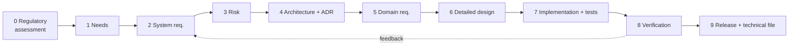

# Development Process

This project is run as if it were developed under a quality management system
(in the spirit of ISO 13485 / IEC 62304 / ISO 26262 lifecycles, without claiming
compliance with any). The goal: every line of firmware, every schematic net and
every mechanical feature is **traceable to a requirement, justified by a recorded
decision, and verified by evidence**.

## 1. Lifecycle (V-model) and gates

| # | Activity | Output (location) | Gate to proceed |
|---|----------|-------------------|-----------------|
| 0 | Regulatory applicability assessment | `docs/regulatory/applicability.md` | Radio / power / connectivity / markets decided; legislation and conformity route identified |
| 1 | Stakeholder needs | `docs/requirements/needs.md` (`NEED-`) | Needs reviewed, approved |
| 2 | System requirements | `docs/requirements/system.md` (`SYS-`) | Every SYS traces to a NEED; every SYS has a verification method; NFR checklist completed |
| 3 | Risk analysis | `docs/risk/risk-register.md` (`RISK-`) | Hazards/failure modes identified; mitigations become requirements |
| 4 | Architecture | `docs/architecture/` (`ARCH-`) + ADRs | Every significant decision has an ADR with >= 2 real alternatives |
| 5 | Domain requirements | `docs/requirements/{sw,hw,mech}.md` | Every SW/HW/MECH req traces to a SYS or ARCH item |
| 6 | Detailed design | `docs/architecture/` or in-repo design notes | Reviewed against requirements |
| 7 | Implementation | `sw/`, `hw/`, `mech/` | **Only against Approved requirements** |
| 8 | Verification | `docs/verification/` (`TC-`) + reports | Each requirement verified with recorded evidence |
| 9 | Release baseline | Signed git tag + release record | Traceability check passes, no open Critical/High findings, **technical file complete, compliance matrix covered, DoC signed** |

Planning for every non-trivial change follows the **Elephant-Goldfish Model** (`planning-egm.md`): design doc with no code,
reviewed by stateless goldfish reviewers, before implementation. Verification rules: `verification-strategy.md`
(**all code ships with tests; hardware is verified by simulation/analysis wherever feasible**).

**No implementation without an Approved requirement.** Exploratory spikes are
allowed only on a branch named `spike/*`, are never merged as-is, and their
findings are written up in an ADR or plan before the real work starts.

*Figure: lifecycle. Each arrow is a gate; see the table above.*

## 2. Document control

Every controlled document begins with a metadata block (see `docs/templates/`):
ID, title, status, version, owner, date, reviewers.

**Status lifecycle:** `Draft` -> `In Review` -> `Approved` -> `Superseded` | `Withdrawn`.

- Changes to an `Approved` document require a PR stating *what changed and why*.
- ADRs are **immutable once Accepted**. To change a decision, write a new ADR that supersedes it.
- Git history is the audit trail. Never rewrite history on `main`.

## 3. Identifiers (never reused, never renumbered)

| Prefix | Meaning | Prefix | Meaning |
|--------|---------|--------|---------|
| `NEED-nnn` | Stakeholder need | `ARCH-nnn` | Architecture element/interface |
| `SYS-nnn` | System requirement | `ADR-nnnn` | Architecture decision record |
| `SW-nnn` | Software requirement | `RISK-nnn` | Risk / hazard |
| `HW-nnn` | Hardware requirement | `TC-nnn` | Test case / verification procedure |
| `MECH-nnn` | Mechanical requirement | | |

Traceability is checked by `scripts/check_traceability.py` (see `trace-check` skill).

## 4. Requirement quality criteria

Each requirement must be: **atomic** (one "shall"), **unambiguous**, **testable**
(has measurable acceptance criteria), **necessary** (has rationale), **feasible**,
and **traceable** (parent + verification). Use "shall". Ban vague words: "fast",
"robust", "user-friendly", "etc.", "appropriate" -- replace with numbers and conditions.

Verification method is one of: **Test**, **Inspection**, **Analysis**, **Demonstration**.

## 5. Non-functional requirements checklist (mandatory for SYS level)

For each, either write a requirement or record an explicit *"not applicable because ..."*:

- **Testability** -- observability/controllability hooks, test points, HIL/sim strategy, test access in production
- **Auditability** -- reproducible builds, version/identity embedded in binaries, logs, signed releases, evidence retention
- **Safety** -- hazards, failure behaviour (fail-safe state), thermal, electrical, photobiological (LED), mechanical
- **Security** -- attack surface, authentication, secure boot, update integrity, secrets handling
- **Reliability / availability** -- MTBF target, watchdog, brown-out, fault recovery
- **Maintainability / updateability** -- firmware update path, rollback, versioned interfaces
- **Compatibility / interoperability** -- protocols, connectors, standards
- **Performance / resources** -- timing, latency, power budget, flash/RAM budget with margin
- **Environmental** -- temperature, humidity, ESD, vibration
- **Regulatory / EMC / cybersecurity** -- applicable legislation (`docs/regulatory/`: CRA, RED/LVD/EMCD, RoHS, REACH, WEEE...), standards, pre-compliance plan, labelling, SBOM, vulnerability handling, support period
- **Manufacturability / supply chain** -- DFM/DFA, second sources, lifecycle status of parts
- **Usability / accessibility** -- indicator visibility, colour-blind safe signalling
- **Sustainability / licensing** -- open-source license compatibility, repairability

## 5a. Engineering standards

Domain design rules live in `docs/standards/`: C coding (CERT C + MISRA C subset), hardware DFx
(testability, manufacturing, assembly, reliability, EMC, cost, serviceability) and mechanical DFx.
They are mandatory review checklists; deviations require a recorded `DEV-nnn`.

## 6. Design decisions (ADRs)

Required for any choice that is costly to reverse or affects more than one domain
(MCU/board, RTOS config, connectivity, power architecture, connector, enclosure
process, update mechanism, license...). An ADR must contain:
context and forces, **decision criteria with weights**, **>= 2 genuinely viable
alternatives** (plus "do nothing"), a comparison, the decision, **consequences
including negative ones**, risks, and how the decision will be verified/revisited.
A strawman alternative is a review finding.

## 7. Reviews

- Every change to a controlled document or to `sw/hw/mech` goes through a PR.
- A review is **critical by design**: the reviewer's job is to find problems.
  Use the checklists in `.github/pull_request_template.md` and the `design-review` skill.
- Review outcome is recorded (PR + `docs/reviews/` for formal reviews of
  requirements/architecture/releases). Findings have a severity
  (Critical/High/Medium/Low) and must be closed or explicitly accepted with justification.
- Where there is a single maintainer, perform the review after a cooling-off period
  using the checklist, and record it as a *self-review*. Do not pretend it is independent.

## 8. Definition of Done

A change is done only when: **user documentation updated and its procedures usability-tested** (user-visible changes); requirement(s) Approved and linked; design doc passed EGM review (non-trivial changes); **tests written and passing for all code**; hardware changes have simulation/analysis results recorded; design decision
recorded where applicable; implementation reviewed; tests/verification evidence
recorded and passing; traceability check passes; docs updated; no new warnings
(`-Werror` for firmware, ERC/DRC clean for hardware, interference check for mechanical).

## 9. Configuration management and release

- `main` is protected; changes arrive via PR; commits are signed where possible;
  messages follow Conventional Commits and reference IDs (`SW-012`, `ADR-0003`).
- West manifest pins exact revisions. No floating branches.
- Builds must be reproducible; the firmware embeds git describe, build date policy
  and a version readable at runtime.
- A release = annotated signed tag + `docs/verification/releases/<version>.md`
  (baseline of requirement versions, test reports, known issues, artefact hashes).
- Hardware releases: tagged, with Gerbers/BOM/PnP in `hw/fabrication/<rev>/` plus ERC/DRC reports.
  Mechanical releases: STEP/STL in `mech/exports/<rev>/`.
