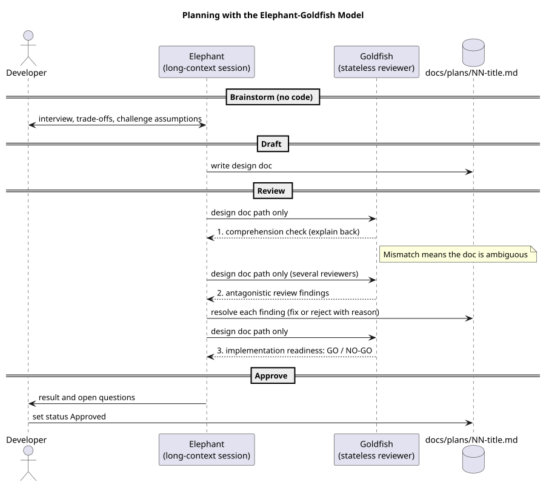

# Planning: Elephant-Goldfish Model (EGM)

Planning follows Google's Elephant-Goldfish Model (source: Google Open Source Blog, Oct 2026,
`google/elephant-goldfish-model`). This is a project-local adaptation, not the official plugin.

## Roles
- **Elephant** -- long-context session (human + the main Claude session) that holds architecture, history and intent.
  **Writes no code** during planning. Interviews the developer, debates trade-offs, challenges assumptions.
- **Goldfish** -- stateless reviewer with **zero conversation context**: a fresh subagent given *only* the design document
  (and the repo files it references). It cannot share the elephant's unstated assumptions, so it exposes them.

*Figure: EGM planning flow. Source: [process-egm-planning.puml](../diagrams/plantuml/process-egm-planning.puml).*

## Phases
1. **Brainstorm** -- elephant interviews; load context (requirements, ADRs, risks). No code, no files in `sw/ hw/ mech/`.
2. **Draft** -- write the design doc `docs/plans/NN-title.md` from `docs/templates/plan.md`: problem, technical plan,
   alternatives considered, detailed implementation plan listing **exact files, data structures, signatures, nets, parts,
   features**, test and verification plan, risks.
3. **Review (goldfish protocol)** -- run three separate goldfish passes (skill `egm-review`):
   1. *Comprehension check* -- goldfish explains the architecture and intent back. If it cannot, the document is ambiguous: redraft.
   2. *Antagonistic review* -- several skeptical goldfish list edge cases, hidden dependencies, logical gaps, missing NFRs.
   3. *Implementation readiness* -- goldfish returns **GO / NO-GO**: are paths, data structures, signatures, test cases unambiguous?
4. **Resolve** -- the elephant resolves critiques (fix doc, or reject with written reasoning). Goldfish output is evidence to
   weigh, not an automatic veto and not applied blindly. Record the outcome in `docs/reviews/` (`RV-nnn`).
5. **Approve** -- the human approves. Only then does implementation begin.

## Applicability
Use EGM for new features, architecture changes, new hardware blocks, new enclosure designs, anything cross-domain.
Trivial fixes (typos, comment fixes, a bug with an already-approved requirement and an obvious one-line cause) skip it,
but still need a failing test first.
