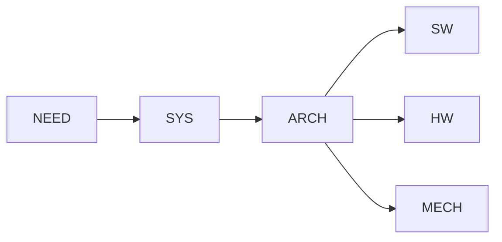
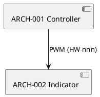

# Diagram source templates (copy into docs/diagrams/...)

## WaveDrom -- `docs/diagrams/wavedrom/hw-example-timing.json`
```json
{ "signal": [
  { "name": "clk",  "wave": "p......" },
  { "name": "data", "wave": "x.345x=", "data": ["head", "body", "tail", "data"] },
  { "name": "busy", "wave": "0.1..0." }
],
  "head": { "text": "Example timing (TBD: replace with real signals and cite HW-nnn)" } }
```

## Mermaid -- inline in Markdown


## PlantUML -- `docs/diagrams/plantuml/arch-example.puml`

