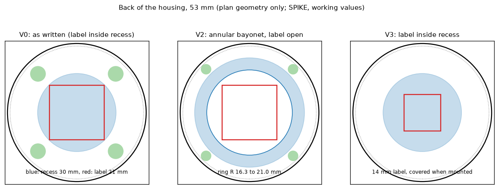
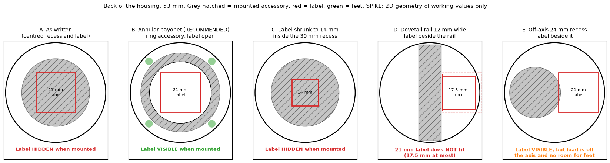

# Spike report: layout of the back of the housing

- **Status:** Draft (spike result, not approved)
- **Date:** 2026-11-04
- **Traces to:** ADR-0014, MECH-006, MECH-007, RV-007 findings G1 and G2
- **Code:** branch `spike/mech-back-layout`, commit 0995c02, `mech/analysis/back_layout.py` and its test (not merged; spike branch)
- **Run:** `python3 mech/analysis/back_layout.py out.png` on 2026-11-04; the 5 tests of `test_back_layout.py` pass (`pytest` on the spike branch)
- **Not run:** height, wall and floor strength, print orientation, tolerances, any 3D model. This checks 2D geometry of working values only.

## Question
Do the bayonet recess (ADR-0014), the unit label (MECH-006) and the four feet (plan 05) fit on the 53 mm back, with the label outside the recess and not covered by an accessory?

## Inputs (working values, millimetres)
Outer diameter 53.0, edge margin 1.0 (so features lie within R 25.5), label 21 x 21 (plan 05; MECH-006 asks at least 20 x 20), bayonet recess diameter 30 (ADR-0014), four feet pads R 3 at R 21 on the diagonals (plan 05), minimum gap between features 0.5, narrowest ring that can carry lugs 4.0.

## Results
| Variant | Result | Detail |
|---------|--------|--------|
| V0 as written: label recess and bayonet recess both centred | **FAIL** | The label corner is at R 14.8 mm, inside the recess radius of 15.0 mm. The label lies inside the recess, so any accessory covers it and MECH-006 ("outside the mounting recess") is violated. |
| V1 label beside the centred 30 mm recess | **FAIL** | The largest square that fits beside the recess is 9.5 mm; the label needs 21 mm. (My first estimate of an 11.5 mm wide ring was right in width; it does not hold a 20 mm square.) |
| V2 annular bayonet around a centred open label | PASS on paper | Ring from R 16.3 to R 21.0 mm (4.7 mm wide), label open in the middle, feet moved to R 23.5 with pad R 2.0 (0.5 mm clear of the ring). Accessories shaped as rings leave the label visible. |
| V3 14 mm label inside the 30 mm recess | PASS | A 21 mm label does not fit with clearance (corner R 14.8 against 14.5). A 14 mm label fits but is covered when an accessory is mounted. |
| V4 label beside a 12 mm wide dovetail rail | **FAIL** | The largest square that fits beside the rail is 17.5 mm; the label needs 21 mm. The dovetail does not solve the layout either. |

## Options for the owner
Each option with the accessory mounted (grey), the 21 mm label (red) and the feet (green). Option B is the recommendation; E is a fifth option found after the first run (an off-axis recess).

| Option | Label readable when mounted | Fits | Main drawback |
|--------|-----------------------------|------|---------------|
| A as written | No, an accessory covers it | Overlaps (violates MECH-006) | The label cannot be read while mounted |
| **B annular bayonet** | **Yes** with ring-shaped accessories | Yes on paper (ring 4.7 mm wide) | Narrow ring for lugs; accessories must leave the centre open; floor and print questions open (G2) |
| C label 14 mm in the recess | No | Yes | Smaller label; passphrase unreadable while mounted |
| D dovetail rail | Yes, but 17.5 mm at most | No for 21 mm | The label is too small |
| E off-axis 24 mm recess | Yes | Yes on paper, no room for feet | Accessory load off the axis, a tilted stand leans to one side |

## Reading
- The finding G1 of RV-007 is confirmed, and stronger than stated: the two centred features collide because the label lies inside the recess.
- The dovetail (option C of ADR-0014) has the same layout problem with a 21 mm label, so it is not an escape.
- V2 is the only variant that keeps the 21 mm label outside the recess **and** readable while a ring-shaped accessory is mounted. It needs: a ring-shaped bayonet (inner R 16.3 to outer R 21.0), feet at the outer edge, accessories that leave the centre open (a blank plate with a window, a stand or clip that bridges only the ring), and the floor thickness and print orientation of finding G2 still to solve.
- V3 keeps the bayonet as drawn but needs a smaller label (14 mm, for the passphrase and QR only) and loses the mounted readability (finding G12).

## What this does not show
The lugs in a ring only 4.7 mm wide, the floor skin of 0.5 mm, the print orientation (a recess on the bed side is a bridge), and the load capacity are not checked; these are findings G2, G5 and G6 and are still open. The 4.0 mm minimum ring width is my working value, not a derived one.

## Proposal (owner decides)
Change ADR-0014 to the annular bayonet of V2 (a new option B2), keep the dovetail as the fallback with the same layout limit noted, and update MECH-006 and MECH-007 after the owner agrees. Until then the ADR stays Proposed.
