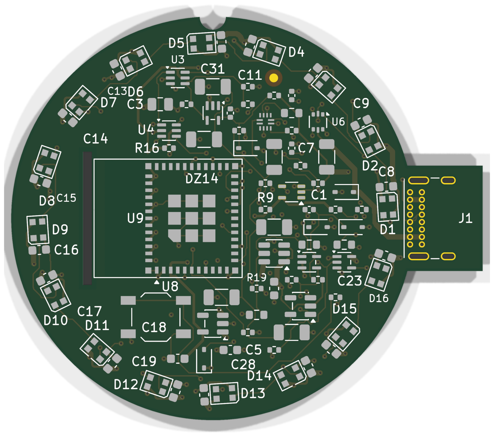
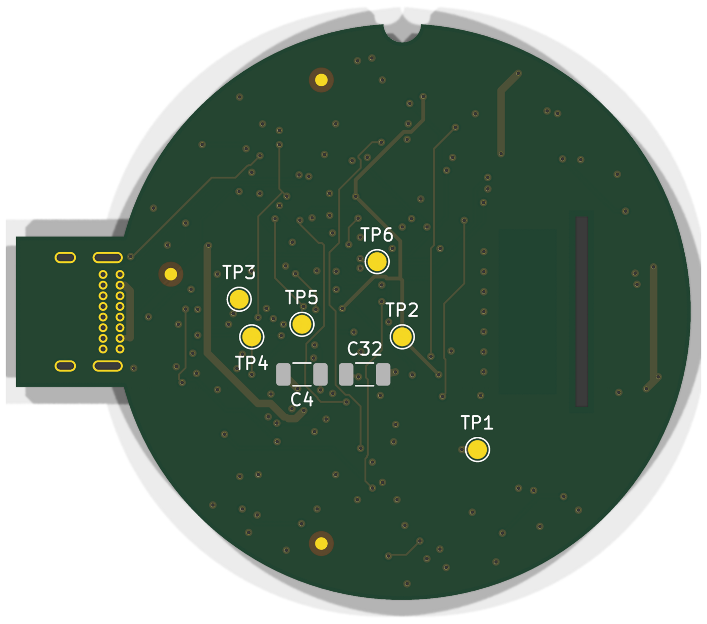
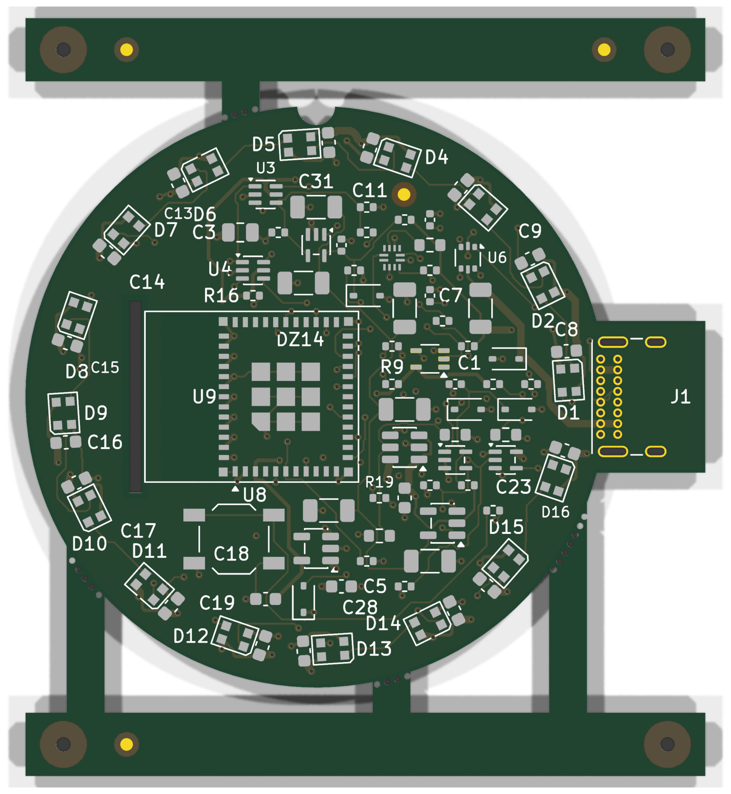

# P1 board result: one side, 46 mm (plan 08, ADR-0023)

The routed 4-layer P1 board with every assembled part on the top side: batch `p1b8` run 3, completed by the second router pass
of `run_repass.sh` (2026-11-20). Freerouting 2.5.0 is not deterministic across placements and runs, so this is one run, not a
recipe. Script output, never edited by hand. Not reviewed or approved; not "DFx approved", not "fully functional", **not ready
to order** (see Open).

## Images
| Top (3D render) | Bottom (3D render) | Order panel (3D render) |
|---|---|---|
|  |  |  |

Copper layers: [`p1-pcb-layers.png`](../../../../docs/verification/reports/images/p1-pcb-layers.png); schematic:
[`p1-schematic-gate-power.png`](../../../../docs/verification/reports/images/p1-schematic-gate-power.png) and
[`p1-schematic-mcu-leds.png`](../../../../docs/verification/reports/images/p1-schematic-mcu-leds.png). Made on 2026-11-21 by
`render_p1_images.sh board-p1 <package>/panel.kicad_pcb docs/verification/reports/images`, with the panel of a
`scripts/fab_p1.sh` package of this board (input sha256 `cc2457c7...7da6`). The renders have no component models for
most parts and are not a fit check.

## How it was made
- Schematic: `run_full.sh` from the generator after ADR-0023 (97 parts). Regenerated on 2026-11-20 from the source of commit
  `5785f0e`: the schematic is byte-identical to the one the batch used, the netlist equal apart from its date and tool lines.
  Strict ERC 0 findings; 52 of 52 intended nets drawn; two builds identical.
- Placement and first routing (batch p1b8, 2026-11-19): `run_best.sh <netlist> <out> 4` with `P1=1`, `PLACE_GRID=1.0`,
  `PLACE_ANT_KEEPOUT=1`, `PLACE_BLOCKS=3`, `PLACE_ORIENT=1.5`, `KEYFIRST=1`, `PRESTITCH=1`, `FR_THREADS=1`,
  `SPIKE_ALLOW_KNOWN_OPEN=0`, 4 layers, planes `inner`, `SEED_OFFSET` 0. Run 3: placement seeds 33 to 48, seed 47 chosen
  (HPWL 997.9 mm, overlap 0.0 mm2). Spares C4 and C32 on the bottom in 1206, LED capacitors clear of the panel tab sectors.
  After the post-route stitch and the clean-up of `src/pcb_fix.py` one connection stayed open (`/ILIM`, R_ILIM2 pad 2).
  `run_meta.json` describes this router run.
- Second router pass (2026-11-20): `run_repass.sh` on the run folder (`KEYFIRST=1`, `FR_THREADS=1`): every track and via of
  the cleaned board locked, Freerouting 60 passes, then stitch, clean-up and strict DRC again; open connections 1 to 0.
  `repass_meta.json` describes this router run (its `placed_board_sha256` is the sha256 of the input board of the pass). A
  scratch run of the same commands on the same board gave the same router score and the same check results.
- Routing tools: KiCad 10.0.8, Freerouting 2.5.0 (Maven Central jar, sha256 `7f8c6247...a976`), OpenJDK 25.0.5.
- Finishing: `src/pcb_finish.py` in three passes (the third with the silkscreen findings of the first two merged), with the
  fiducials placed before the designators (fix of 2026-11-20). 50 reference designators on the silkscreen, 47 parts without
  room. Fiducials: FID1 on the top, FID4 to FID6 on the bottom; the KiKit panel adds three on the rails (`scripts/panel_p1.json`).
  Routing did not change.
- Sourcing: `src/pcb_sourcing.py` against the schematic: no field changed.

## Checks run on these files (2026-11-20)
- Strict ERC `full`: 0 findings. Strict DRC `stitched-4l` (`SPIKE_ALLOW_KNOWN_OPEN=0`): only the tolerated classes
  `courtyards_overlap` 14 (max 14, all with U9; DEV-004) and `items_not_allowed` 1 (U9 in the hook rule area; DEV-004). No
  unconnected item, no clearance finding. `scripts/ci_hw.sh` exit 0 (its regeneration check is NOT RUN: no
  `hw/kicad/src/generate.py`).
- `src/pcb_fabcheck.py --no-via-in-pad`: PASS. 174 vias, 0 in an SMD pad; track 0.15 mm minimum; via 0.6 / 0.3 mm; annular ring
  0.15 mm on all 174 vias (the absolute minimum, below the recommended ring; ADR-0020 is Proposed).
- `src/pcb_power_check.py` (analyst currents; 50 mV is an analyst target, not a requirement; full-width rule 0.75 x the net's
  width, also the assistant's): +3V3 7.3 mV at 0.5 A, +5V 10.0 mV at 1.0 A, VBUS 23.9 mV at 1.5 A, VBUS_IC 44.1 mV at 1.5 A; every
  case with a full-width path. Planes: In1 GND one piece (13 % removed by other copper), In2 +5V one piece (26 % removed;
  305 mm of signal track on In2).
- Sides: every assembled part on the top. On the bottom: TP1 to TP6, the DNP spares C4 and C32 (out of the BOM), FID4 to FID6.
- `tests/test_board_p1.py`: 6 passed (sides, HW-016 spares within 10 mm of U7 pin 6, HW-017 link, supply drops and full-width
  paths, panel tabs).
- Order package `scripts/fab_p1.sh`: exit 0, all gates passed (strict ERC and DRC, fab check, power check, panel tabs at 105,
  217.5, 285 and 330 deg with the nearest capacitor 4.85 mm from a tab, KiKit panel and JLCPCB files, assembly PDF,
  `fab_check.py`: 88 assembled refs, BOM equals CPL, all on top, ILIM resistors 0.1 %; R22 and U5 without an LCSC number,
  allowed by `scripts/fab_missing_lcsc.txt`). The package is build output and is not committed.

## Open (owner)
- Review RV-016 (2026-11-22, `docs/reviews/RV-016-p1-plan-rev5-as-built-goldfish.md`): **not ready to order**. Gate safety
  after ADR-0023, missed placement rules, a main path below 0.6 mm, the full BOM without C4 and C32, MECH-001 and unverified
  footprints; the board is to be placed and routed again after the owner's decisions (plan 08 section 0.5).
- U5 TPS3840DL40DBVR has no LCSC or JLCPCB listing (the hold-off of HW-010 needs it); R22 candidate up to 20 mohm against
  HW-017 [10] mohm.
- Superseded for the next board: the owner replaced U5 by the TPS3808G01DBVR (ADR-0025, 2026-11-24) and reworked the gate
  (ADR-0024). The generator carries both; this stored board still has the TPS3840 and is not regenerated. The successor is
  the round 58.5 mm board of plan 08 section S (ADR-0027); nothing has been placed or routed for it.
- The assistant's picks: spares on the bottom in 1206; tab azimuths; the 0.75 full-width rule and the 50 mV target.
- Not run: housing fit (FreeCAD), antenna range with the module 5 mm closer to the edge (TC-205), thermal, the fab-release
  workflow on GitHub, JLCPCB DFM upload and price, bench (TC-208, TC-210, TC-216, TC-217).
